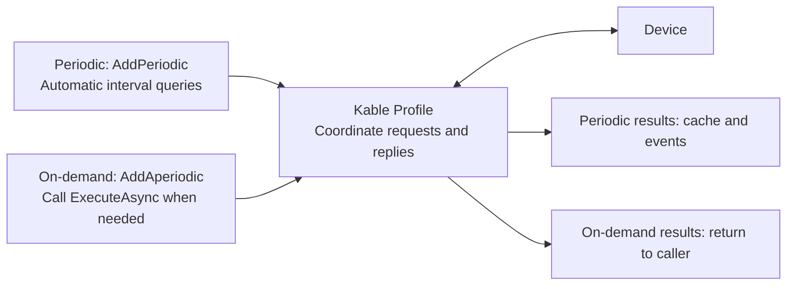

# Kable

Asynchronous device communication for .NET 8, .NET 10 and netstandard2.0.
Connect, query, poll and recover connections using the API that matches your equipment.

Latest release: **[1.10.1](https://www.nuget.org/packages/Kable/1.10.1)** (2026-10-29). Read the [release notes and upgrade guidance](docs/releases/1.10.1.md)
or the [changelog](CHANGELOG.md). The installation command below selects the version available on NuGet.

Read the [installation, security and release guide](docs/en/RELEASE_GUIDE.md) before upgrading or publishing.

## Start with one query

Add the package from your .NET application project directory. For a new app, first run `dotnet new console -n KableDemo` and `cd KableDemo`.

```bash
dotnet add package Kable
```

```csharp
using Kable.Simple;

await using var device = await KableSimple.OpenTcpAsync("192.168.0.100", 9000);
string status = await device.QueryAsync("STATUS?");
Console.WriteLine(status);
```

Replace the endpoint and command with your device's specification. The defaults are ASCII
and LF framing. OpenTcpAsync returns a started client; no separate Thread, Task.Run or
StartAsync is required for ordinary communication. Await using performs asynchronous cleanup.

Without hardware, run the repository's local mock-device example:

```bash
dotnet run --project samples/Kable.QuickStart/Kable.QuickStart.csproj
```

## Choose your API

| Your task | Entry point |
| --- | --- |
| String command and one-line reply | `KableSimple` |
| Periodic polling and latest-value cache | `KableProfileManager` |
| Binary/custom protocol and framing | `KableClientBuilder<T>` with a codec |
| Modbus or MELSEC | `Kable.Modbus` or `Kable.Melsec` client |
| Automatic reconnection | [`ReconnectingKableClient`](docs/en/ERROR_HANDLING.md#optional-connection-recovery) |
| Incoming multi-client server | `KableServerBuilder<T>` / `IKableServer<T>` |

Builder sessions need StartAsync after Build. Simple Open and Profile Connect return started clients.
Server listeners accept incoming 1:N connections via `IConnectionListener.AcceptAsync()` and run session loops concurrently.
Internal asynchronous loops handle sending, receiving and reply routing; they do not each reserve
a dedicated OS thread. Keep and cancel a Task only for application-owned repeated work.

## Register continuous polling, call on-demand queries

**Register commands and intervals** for values such as status and temperature.
Keep **on-demand commands separate** for buttons and workflow steps.



Configure continuous polling without an application timer or loop, and use `TryGetFresh` for recent cached values.
On-demand commands execute once per call and share session request coordination with polling.
See [the polling diagrams, short example and basic API comparison](docs/en/WHY_KABLE.md).

## Read in this order

1. [First connection and polling](docs/en/GETTING_STARTED.md): transports, API choice, Tasks and Profile.
2. [Configuration and events](docs/en/DEVELOPER_USAGE.md): connection/query deadlines, event routing and UI dispatch.
3. [Failures and shutdown](docs/en/ERROR_HANDLING.md): timeout handling, optional recovery and cleanup.
4. [Connection lifecycle](docs/en/CONNECTION_LIFECYCLE.md): FIFO/CID contracts and session reuse.

Server setup and shutdown: [multi-client server hosting](docs/en/SERVER_HOSTING.md).

## Configuration and failure rules

- Connection timeout and reply timeout are separate settings.
- QueryAsync returns the matched reply. LineReceived delivers unmatched/event lines on a background path.
- Handle query errors where you await the query; ErrorOccurred is not an all-errors channel.
- A transmitted FIFO request that times out or is canceled closes its connection. Create a new client.
- The automatic reconnection client creates new connections and does not replay failed commands.
- Before repeating a motion/write command, check actual device state.
- Cancel and await application workers, unsubscribe handlers and dispose asynchronously.

## Packages and extension points

| Package | Purpose |
| --- | --- |
| `Kable` | Simple, Profile, Builder, TCP/Serial/Named Pipe, codecs and simulator |
| `Kable.Core` | Contracts, protocol building blocks and shared types |
| `Kable.Modbus`, `Kable.Melsec` | Modbus-TCP and MELSEC SLMP clients/codecs |
| `Kable.OpcUa`, `Kable.Mqtt`, `Kable.Grpc` | Protocol bridges and streaming integrations |
| `Kable.SharedMemory` | Windows shared-memory transport and waveform buffers |
| `Kable.UI.Wpf` | WPF communication terminal and diagnostics controls |
| `Kable.Observability.OpenTelemetry` | OpenTelemetry integration |

The library reuses pipeline buffers. String decoding and asynchronous queries allocate;
see the [measured scope](docs/ko/PERFORMANCE_BASELINE.md) before interpreting allocation claims.

For extension contracts and dependency injection, continue with
[architecture](docs/en/01_ARCHITECTURE_OVERVIEW.md), [core interfaces](docs/en/02_CORE_INTERFACES.md)
and [observability](docs/en/03_OBSERVABILITY_LOGGING.md).

## Documentation and source

- [한국어 시작 가이드](README.ko.md)
- [GitHub Pages documentation](https://johnny-hw.github.io/Kable/)
- [Compiled QuickStart examples](https://github.com/Johnny-HW/Kable/tree/main/samples/Kable.QuickStart)
- [Repository](https://github.com/Johnny-HW/Kable) · [Apache-2.0 license](LICENSE)
