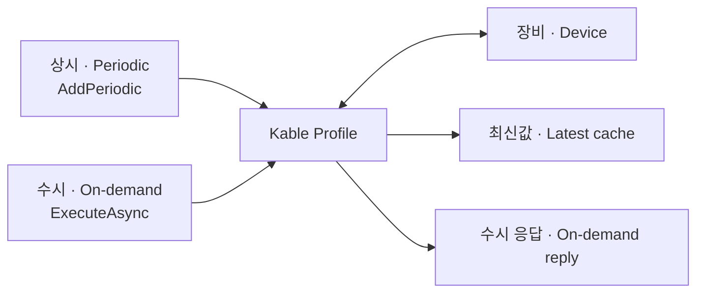

# Kable · 장비 폴링을 설정으로 구성하세요

**상시 폴링은 등록하고, 수시 조회는 필요할 때 호출하세요.**
Register periodic items and intervals, then call on-demand commands from your workflow.

| 언어 · Language | 컨셉과 예제 · Concepts | 시작하기 · Get started |
| --- | --- | --- |
| 한국어 | [상시·수시 폴링과 기본 API 비교](ko/WHY_KABLE.md) | [한국어 메인](ko/README.md) |
| English | [Polling workflows and basic API comparison](en/WHY_KABLE.md) | [English overview](en/README.md) |

## 사용 가이드 · Usage guides

[설치·지원 환경](ko/RELEASE_GUIDE.md) · [Installation](en/RELEASE_GUIDE.md) ·
[오류 처리·자동 재연결](ko/ERROR_HANDLING.md) · [Failures and reconnection](en/ERROR_HANDLING.md)

## 검증 자료 · Verification

[성능 비교 · Performance](ko/benchmarks/LibraryComparison.md) ·
[오류 처리 비교 · Fault handling](ko/benchmarks/FaultComparison.md)

## 릴리즈 · Releases

[1.10.1 한국어](releases/1.10.1.ko.md) · [1.10.1 English](releases/1.10.1.md)

## 다른 언어 · Other languages

[繁體中文](zh-tw/README.md) · [简体中文](zh-cn/README.md) · [日本語](ja/README.md) ·
[Deutsch](de/README.md) · [Español](es/README.md)

.NET 8 · .NET 10 · netstandard2.0 · [GitHub](https://github.com/Johnny-HW/Kable)
