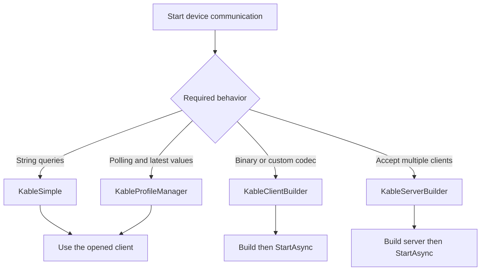
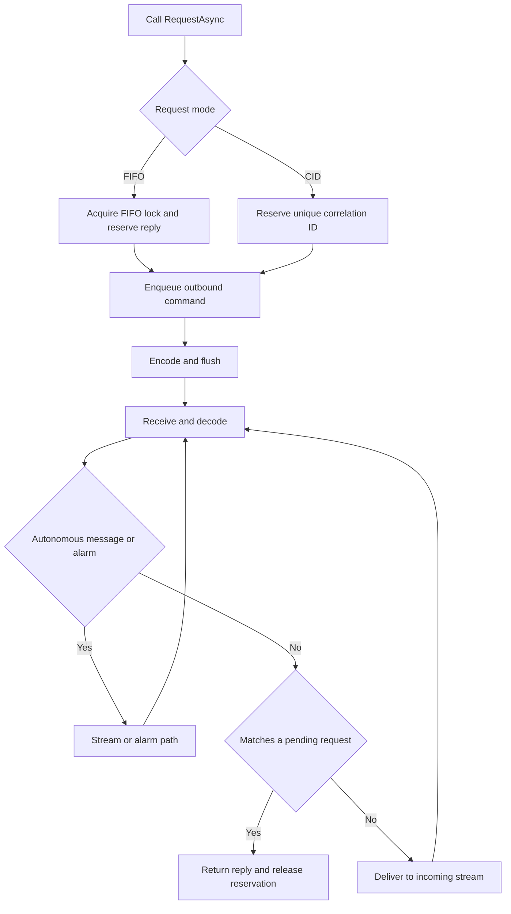

# Configuration and event contracts

Start with [your first connection](en/GETTING_STARTED.md), then use this page for defaults,
configuration precedence and advanced sessions. [Failures and shutdown](en/ERROR_HANDLING.md)
describes what to do after an exception.

## Choose an API and follow a request



Use the protocol clients for Modbus or MELSEC. The following is the general client-session request path.



Request deadlines include FIFO lock and outbound waits. See the [failure flow](en/ERROR_HANDLING.md)
for timeout, cancellation and disconnect behavior. Correlated codecs must supply a valid request CID.

## Connection and request timeouts are different

```csharp
using Kable.Simple;

var options = new KableSimpleOptions
{
    ConnectTimeoutMs = 5000,
    DefaultTimeout = TimeSpan.FromSeconds(2)
};
await using var device = await KableSimple.OpenTcpAsync("192.168.0.100", 9000, options);
string status = await device.QueryAsync("STATUS?");
string version = await device.QueryAsync("VERSION?", TimeSpan.FromSeconds(4));
Console.WriteLine($"{status}; {version}");
```

The connection has a 5-second deadline. Queries default to 2 seconds; the explicit VERSION
deadline overrides it with 4 seconds. Increasing a connection deadline does not extend query waits.

| Setting | Scope | Default / precedence |
| --- | --- | --- |
| DeviceOptions `ConnectTimeoutMs` | TCP/Named Pipe connection | Overrides legacy `TimeoutMs`; positive values required |
| DeviceOptions `TimeoutMs` | Legacy connection fallback | 3000ms; does not set the query timeout |
| DeviceOptions `DefaultRequestTimeoutMs` | Request extension and Simple defaults | 3000ms; explicit query timeout wins |
| Simple `DefaultTimeout` | `QueryAsync` default | 3 seconds; explicit query timeout wins |
| Simple `ConnectTimeoutMs` | `OpenTcpAsync` connection | 0 keeps the transport default; negative values rejected |

`KableSimple.OpenAsync(deviceOptions, simpleOptions)` takes connection settings from
deviceOptions and the query default from simpleOptions when supplied.
Serial opening does not use DeviceOptions' connection deadline.
The direct `OpenNamedPipeAsync` overload uses its `timeoutMs` argument.

## Builder and configured requests

```csharp
using Kable.Codecs;
using Kable.Configuration;
using Kable.Extensions;

var options = new KableDeviceOptions
{
    Host = "192.168.0.100", Port = 9000,
    ConnectTimeoutMs = 5000, DefaultRequestTimeoutMs = 1500
};
await using var session = new KableClientBuilder<string>()
    .UseOptions(options).UseCodec(new AsciiLineCodec()).Build();
await session.StartAsync();
Console.WriteLine(await session.RequestAsync("STATUS?"));
```

The request extension returns the session's message type and uses its configured default.
External sessions without `IRequestTimeoutProvider` use 3 seconds.
The original `RequestAsync<TResponse>(request, timeout, ct)` requires its own timeout.
`FromSessionAsync` also adopts the session's request default when available.

Use `UseSessionOptions` for queue capacities/alarm policy and `UseHeartbeat` for a
device-specific ping/pong contract before Build. Do not mutate options after building.
Heartbeat replies must be distinguishable from ordinary FIFO replies.

## Reply classification and events

`QueryAsync` returns the matched reply. `LineReceived` delivers lines not consumed as replies.
To observe all traffic, configure an `ICommObserver`.

Simple's default autonomous-message prefixes are `$`, `#`, `!` and `*`.
If a normal device reply is `!OK`, configure the actual event rule explicitly:

```csharp
using Kable.Simple;

var options = new KableSimpleOptions
{
    IsAutonomousMessage = message => message.StartsWith("$", StringComparison.Ordinal)
};
await using var device = await KableSimple.OpenTcpAsync("192.168.0.100", 9000, options);
Console.WriteLine(await device.QueryAsync("STATUS?"));
```

Session-level alarm classification still applies. Choose rules that match the equipment.
`LineReceived`, recovery and polling events execute on background processing paths.
Keep handlers short and marshal UI changes through the UI framework's dispatcher.
`await` does not automatically marshal background events to the UI thread.
Await each query to handle its error; `ErrorOccurred` is not an all-errors channel.

Keep a named delegate when a view or component needs to unsubscribe:

```csharp
using Kable.Simple;

await using var device = await KableSimple.OpenTcpAsync("192.168.0.100", 9000);
Action<string> onLine = line => Console.WriteLine($"Event: {line}");
device.LineReceived += onLine;
try
{
    Console.WriteLine(await device.QueryAsync("STATUS?"));
}
finally
{
    device.LineReceived -= onLine;
}
```

No dedicated application Thread or Task.Run is needed for these calls.
For an application-owned worker, retain its Task, cancel it and await it before disposal;
see [the polling example](en/GETTING_STARTED.md).

## Recovery and compatibility

Connection recovery is opt-in through `ReconnectingKableClient` and uses fresh sessions.
It does not automatically re-execute a failed motion/write command.
See [failures](en/ERROR_HANDLING.md) and [the lifecycle matrix](en/CONNECTION_LIFECYCLE.md).

The examples use modern .NET syntax. PeriodicTimer examples require .NET 8/10 in this guide.
The core library also targets netstandard2.0; legacy applications need compatible async
disposal/language support and their own platform-appropriate application timer.
Compiled repository examples are in [Kable.QuickStart](https://github.com/Johnny-HW/Kable/tree/main/samples/Kable.QuickStart).


## Protocol Pack

This feature is planned for 1.9.2; publication is pending. Put the parent YAML and command/map files under `Protocol/` and add:

```xml
<ItemGroup>
  <AdditionalFiles Include="Protocol\**\*.kable.yaml" />
</ItemGroup>
```

Reference `Kable` and a build of `Kable.Generators` containing Protocol Pack support. With the MassHunter-7700 generator fixture:

```csharp
using Icpms.MassHunter.Protocol;

var options = MassHunter7700Protocol.CreateDeviceOptions();
var command = new IgnitePlasmaCommand();
string wire = command.FormatWireMessage(); // oPON
```

Creating options does not open a connection. Reply enums do not parse responses; the application must interpret incoming strings. Modbus/MELSEC emit map constants, not read/write helpers. Loading/saving uses synchronous file I/O and belongs outside communication loops.

RTU distinguishes supported request/response FCs by length and CRC. SLMP 3E supports both directions; check `IsResponse && IsSuccess` for successful responses. Both codecs retain FIFO contracts without correlation IDs. See the [schema, diagnostics and limitations (Korean)](../PROTOCOL_PACK.md).

## Heartbeat and binary length limits in 1.10.1

Heartbeat monitoring continues checking inbound inactivity while a Ping write is pending.
Only one Ping send is pending at a time. Inbound inactivity beyond Timeout or a PingFactory
failure closes the connection; reconnect with a new session.

On .NET 8/10, HeartbeatOptions.TimeProvider also controls request deadlines. The default is
system time. Tests using virtual time must advance that clock to trigger request timeouts.
netstandard2.0 request deadlines continue using system timers.

The BinaryLengthPrefixedCodec constructor's maxFrameSize argument limits payload size;
the header is additional. Encode checks the configured limit and header representable range
before writing and throws ArgumentOutOfRangeException for oversized payloads. A two-byte
header supports at most 65,535 payload bytes, even with the default 65,536-byte configuration.
This describes direct Encode calls. An encoding failure inside a session's send pump can close
the session, so validate payload sizes before sending.
