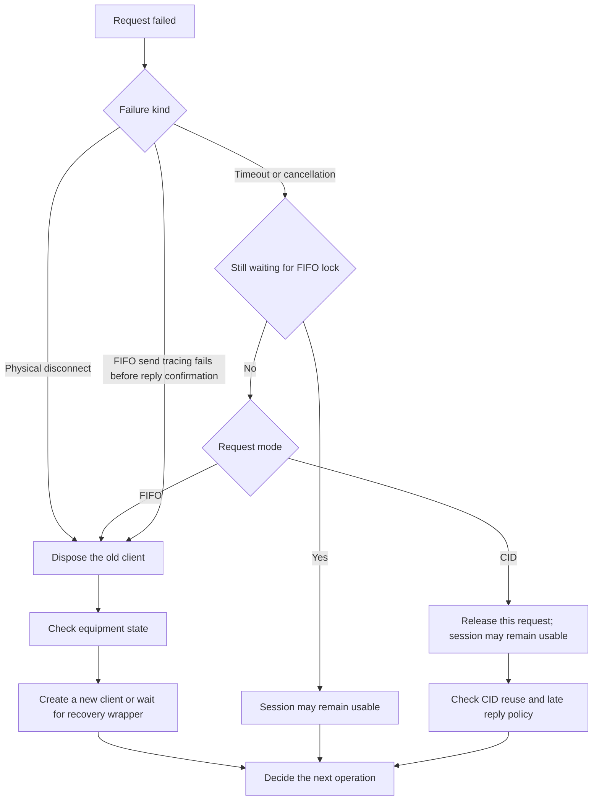

# Failures and shutdown

Start with [your first connection](en/GETTING_STARTED.md) for the normal string-query flow.
Replace the sample endpoint and commands with your device's specification.

## Decide what to do after failure



FIFO timeout or cancellation after acquiring the lock closes the connection even during outbound waits.
This flow covers general client requests. Initial connection failures and server sends follow their own guides.
A failed command may have executed; recovery wrappers do not automatically replay failed commands.

## What to do after a failure

| Situation | Result visible to the caller | Next action |
| --- | --- | --- |
| Initial connection fails | Exception from the connection method | Check endpoint, equipment and transport configuration |
| FIFO reply times out after transmission | `DeviceTimeoutException`, connection closed | Dispose and open a new client; check whether the equipment executed the command |
| FIFO request canceled after transmission | `OperationCanceledException`, connection closed | End the canceled application operation; reconnect before resuming |
| Canceled before request/FIFO lock acquired | Cancellation exception; session can remain usable | Handle cancellation; consult the lifecycle matrix |
| Physical disconnection | Pending requests fail with `DeviceDisconnectedException` | Restore connectivity and check device state |
| CID request times out | The request fails; session can remain usable | Follow the protocol's CID reuse and late-response rules |
| Request during recovery | `DeviceDisconnectedException` | Observe recovery before deciding the next operation |

An exception does not prove that the equipment did not execute a command.
Check actual device state before repeating motion, write or start commands.
Calling `StartAsync` again on the same closed session does not restore it.

## Handle QueryAsync failures where you await them

```csharp
using Kable.Exceptions;
using Kable.Simple;

using var lifetime = new CancellationTokenSource();
try
{
    await using var device = await KableSimple.OpenTcpAsync("192.168.0.100", 9000, ct: lifetime.Token);
    Console.WriteLine(await device.QueryAsync("STATUS?", TimeSpan.FromSeconds(2), lifetime.Token));
}
catch (DeviceTimeoutException ex)
{
    Console.Error.WriteLine($"{ex.Command}: no reply within {ex.Timeout}. Reconnect and check device state.");
}
catch (DeviceDisconnectedException ex)
{
    Console.Error.WriteLine($"Disconnected: {ex.Message}");
}
catch (OperationCanceledException) when (lifetime.IsCancellationRequested)
{
    Console.WriteLine("The caller canceled the operation.");
}
```

Initial connection errors or other exceptions not caught here propagate to the application.
The `ErrorOccurred` event does not replace awaiting and handling `QueryAsync` failures.
Use it to observe background receiving and event-handler failures.

## Optional connection recovery

```csharp
using Kable.Simple;
using Kable.Simple.Reconnecting;

using var lifetime = new CancellationTokenSource();
await using var device = await ReconnectingKableClient.OpenAsync(
    ct => KableSimple.OpenTcpAsync("192.168.0.100", 9000, ct: ct),
    new ReconnectOptions
    {
        MaxAttempts = 3,
        RetryDelay = TimeSpan.FromSeconds(1),
        ConnectTimeout = TimeSpan.FromSeconds(5)
    }, lifetime.Token);
Action onReconnected = () => Console.WriteLine("A new connection is ready. Check device state.");
device.Reconnected += onReconnected;
try
{
    Console.WriteLine(await device.QueryAsync("STATUS?", ct: lifetime.Token));
}
finally
{
    device.Reconnected -= onReconnected;
}
```

This short example demonstrates recovery options and subscription lifetime. Keep the wrapper
alive while the application needs recovery. Initial connection errors propagate from OpenAsync.
Subsequent outages are restored using new clients. Failed commands are not replayed or queued.
`Reconnected` indicates connectivity, not successful execution of a previous command.
Inspect `RecoveryTask` and `LastError` when retries are exhausted.
The OpenAsync token applies to the initial connection. DisposeAsync ends the returned wrapper's lifetime.

## Shutdown sequence

1. Stop scheduling new device operations in the application.
2. Cancel the token for application-owned repeated work.
3. Await the retained worker Tasks. Handle expected cancellation and report other errors.
4. Unsubscribe events and dispose the client with `DisposeAsync` or `await using`.

See the [cancel-and-await example](en/GETTING_STARTED.md) for application polling.
Do not block inside communication events with `.Wait()`, `.Result` or synchronous disposal.
[Configuration and events](en/DEVELOPER_USAGE.md) explains UI-thread dispatch.

For diagnostics, retain the exception, device ID/endpoint, command, connection/query deadlines
and recent `ICommObserver` traffic. See [observability](en/03_OBSERVABILITY_LOGGING.md).

## Diagnostic failures and FIFO lifetime in 1.10.1

If send tracing fails after a FIFO command is transmitted but before its response is confirmed,
the session closes. Dispose that client and create a new connection even when the caller sees
an observer exception. Check equipment state before retrying: transmission may have succeeded.

FIFO timeout logging failures do not replace DeviceTimeoutException. The logging failure is
retained in ex.Data["TraceException"]. If message ToString() fails, Command is "UnknownCommand"
and ex.Data["CommandFormattingException"] retains the cause. These entries exist only when
that diagnostic operation fails. This isolation does not extend to observer exceptions in the
CID timeout logging path.
