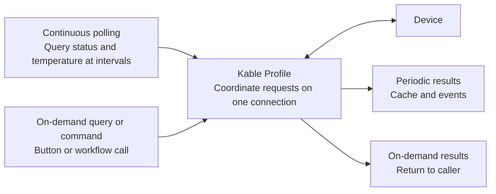

# Kable · Register continuous polling, call on-demand queries

**Register commands and intervals; Kable manages repeated queries, reply coordination and latest values.**
Asynchronous device communication for .NET 8, .NET 10 and netstandard2.0.



| Application task | What you write | Kable feature |
| --- | --- | --- |
| Keep reading device status | Register items, commands and intervals | `AddPeriodic` automatic polling |
| Query once when needed | Register and call an on-demand command | `AddAperiodic` + `ExecuteAsync` |
| Use recent values in the UI | Choose the acceptable data age | `TryGetFresh` cache access |

[Explore periodic and on-demand workflows](WHY_KABLE.md) · [Compare implementation responsibilities with basic .NET APIs](WHY_KABLE.md#building-the-same-behavior-with-basic-net-apis)

## Configure polling and on-demand queries together

Run `dotnet add package Kable` in the project directory.
This .NET 8/10 console example uses an equipment-specific endpoint and commands; replace them for your device.

```csharp
using Kable.Engine.Profiles;

var config = new KableProfileConfig<PeriodicItem, OnDemandCommand>()
    .UseTcp("192.168.0.100", 9000)
    .AddPeriodic(PeriodicItem.Status, "STATUS?", TimeSpan.FromSeconds(1))
    .AddPeriodic(PeriodicItem.Temperature, "TEMP?", TimeSpan.FromMilliseconds(500))
    .AddAperiodic(OnDemandCommand.ReadModel, "MODEL?");

await using var device = await KableProfileManager.ConnectAsync(config);

string model = await device.ExecuteAsync(OnDemandCommand.ReadModel);
Console.WriteLine(model);

await Task.Delay(TimeSpan.FromSeconds(10));
if (device.TryGetFresh(PeriodicItem.Status, TimeSpan.FromSeconds(3), out var status))
    Console.WriteLine(status);

enum PeriodicItem { Status, Temperature }
enum OnDemandCommand { ReadModel }
```

Periodic items repeat automatically after connection; on-demand commands execute once per call.
The ten-second delay keeps the demonstration alive. `TryGetFresh` returns false if no reply has arrived or the value is stale.

## Choose your entry point

| Need | API and guide |
| --- | --- |
| Send a single string query | [KableSimple getting started](GETTING_STARTED.md) |
| Periodic and on-demand queries with a cache | [Profile workflows and example](WHY_KABLE.md) |
| Binary or custom framing | [Builder and codecs](DEVELOPER_USAGE.md) |
| Modbus, MELSEC and protocol extensions | [Features and usage (Korean)](/ko/SOFTWARE_HARDENING_USAGE.md) |
| Automatic reconnection | [ReconnectingKableClient usage](ERROR_HANDLING.md#optional-connection-recovery) |
| Incoming multi-client server | [Server hosting](SERVER_HOSTING.md) |

## Continue

[Installation and supported environments](RELEASE_GUIDE.md) · [Configuration and events](DEVELOPER_USAGE.md) ·
[Failures and shutdown](ERROR_HANDLING.md) · [Session lifetime](CONNECTION_LIFECYCLE.md)

[Performance comparison (Korean)](/ko/benchmarks/LibraryComparison.md) · [Fault comparison (Korean)](/ko/benchmarks/FaultComparison.md) ·
[1.10.1 release notes](/releases/1.10.1.md) · [GitHub repository](https://github.com/Johnny-HW/Kable)
