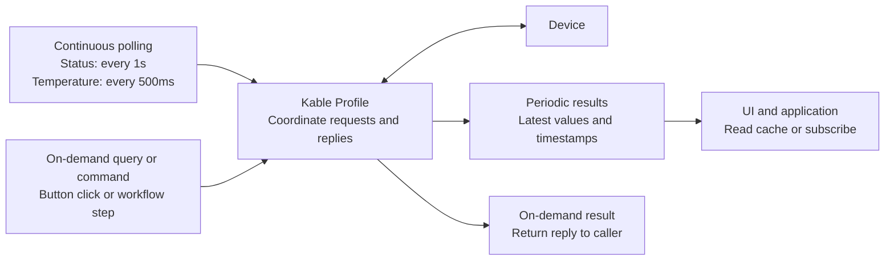
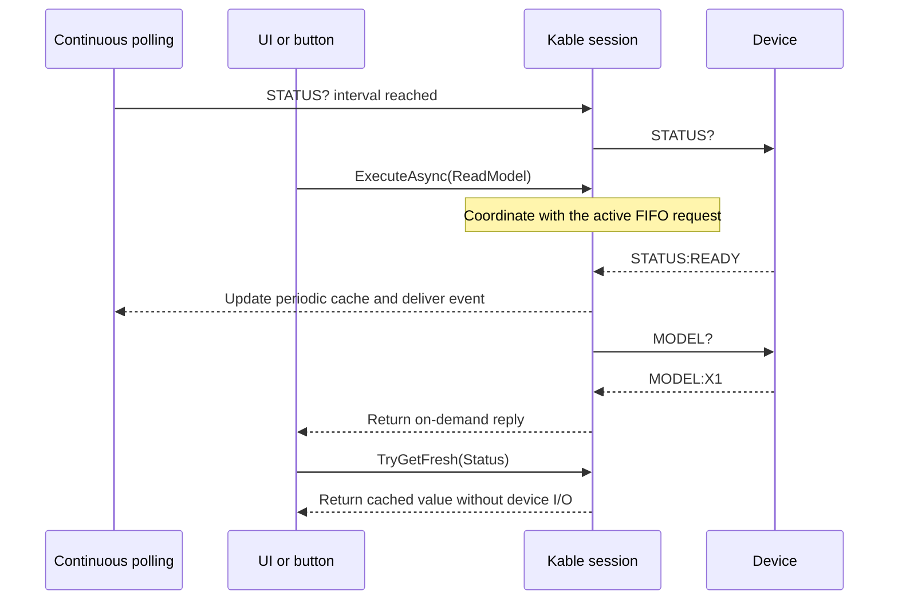
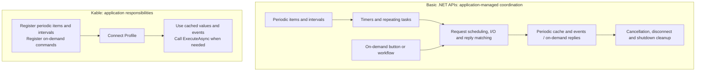

# Kable: register continuous polling, call on-demand queries

**Register device commands and intervals; Kable manages repeated queries, reply matching and latest values.**
Application code defines the required data and business triggers instead of rebuilding timers and receive loops.

## Continuous polling and on-demand queries share a connection



| Mode | Trigger | Registration and use | Application code |
| --- | --- | --- | --- |
| **Continuous polling** | Repeated registered intervals after connection | `AddPeriodic` → `TryGetFresh` / `PeriodicDataReceived` | Items, commands, intervals and value consumers |
| **On-demand query/command** | Button click or workflow call | `AddAperiodic` → `ExecuteAsync` | Register the command and call it where needed |

On-demand commands execute once per call. Register repeating queries as periodic items.
Separate Enum types, such as `PeriodicItem` and `OnDemandCommand`, distinguish cache access from on-demand execution.

## Configure both behaviors together

.NET 8/10 console example. Install with `dotnet add package Kable` and replace the device endpoint and commands.

```csharp
using Kable.Engine.Profiles;

var config = new KableProfileConfig<PeriodicItem, OnDemandCommand>()
    .UseTcp("192.168.0.100", 9000)
    .AddPeriodic(PeriodicItem.Status, "STATUS?", TimeSpan.FromSeconds(1))
    .AddPeriodic(PeriodicItem.Temperature, "TEMP?", TimeSpan.FromMilliseconds(500))
    .AddAperiodic(OnDemandCommand.ReadModel, "MODEL?");

await using var device = await KableProfileManager.ConnectAsync(config);

string model = await device.ExecuteAsync(OnDemandCommand.ReadModel);
Console.WriteLine(model);

await Task.Delay(TimeSpan.FromSeconds(10));
if (device.TryGetFresh(PeriodicItem.Status, TimeSpan.FromSeconds(3), out var status))
    Console.WriteLine(status);

enum PeriodicItem { Status, Temperature }
enum OnDemandCommand { ReadModel }
```

- Two `AddPeriodic` registrations define different polling intervals; no application timer or polling loop is needed.
- `ExecuteAsync` requests an on-demand reply through the same session as periodic polling.
- `TryGetFresh` reads an acceptably recent cached value without another device query.
- The ten-second delay keeps this demonstration alive. `TryGetFresh` returns false when no reply has arrived or the cached value is stale.

For string keys, use `KableProfileConfig` with `AddPeriodic` and `AddCommand`.

## A button click while polling



This illustrates FIFO behavior. An on-demand command does not preempt the active request or imply priority scheduling.
Dispatch event handling to the application's UI thread when required.

## Building the same behavior with basic .NET APIs



| Requirement | Coordination over basic APIs | Kable feature |
| --- | --- | --- |
| Collect values at intervals | Repeating tasks, intervals and task lifetime | Profile polling |
| Mix periodic and on-demand work | Request ordering and reply waiting on one connection | FIFO request coordination |
| Reuse recent values in the UI | Values, timestamps and acceptable age | Latest-value cache and `TryGetFresh` |
| Receive alarms during queries | Classify and dispatch unsolicited messages | Codec rules and session delivery |
| Cancel or close a connection | Complete waiters, handle late replies and release resources | Session lifetime contract and `DisposeAsync` |
| Recover connectivity | Replace connections and manage retries | Separate optional `ReconnectingKableClient` |

Basic APIs can implement these behaviors. Kable provides the shared communication coordination to reduce
what each application builds and maintains. The recovery wrapper is a separate feature; the Profile example
does not enable automatic reconnection by itself.

[Getting started](GETTING_STARTED.md) · [Failures and new connections](ERROR_HANDLING.md) ·
[Session lifetime](CONNECTION_LIFECYCLE.md) · [Fault report in Korean](../ko/benchmarks/FaultComparison.md)
