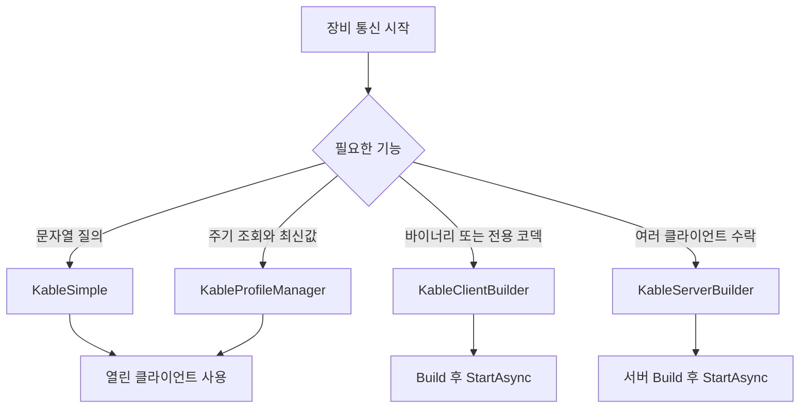
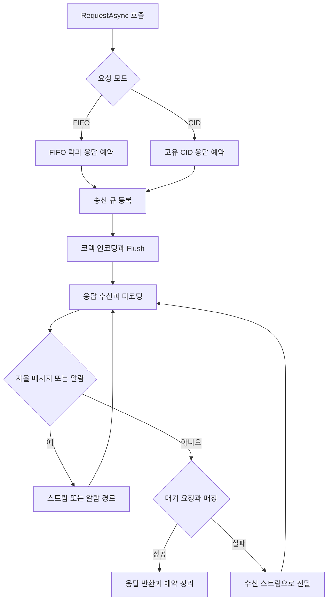

# 개발자 API 사용 가이드

[처음 연결하는 순서](ko/GETTING_STARTED.md)에서 Simple/Profile/Builder를 선택한 뒤 이 문서의
설정 우선순위와 이벤트 계약을 참고한다. 실패 후 다음 행동은 [실패 처리와 종료](ko/ERROR_HANDLING.md)에 있다.

## API 선택과 요청 흐름



Modbus·MELSEC는 해당 프로토콜 클라이언트를 사용한다. 아래는 일반 클라이언트 세션의 요청 흐름이다.



요청 제한시간에는 FIFO 락 대기와 송신 대기도 포함된다. timeout·취소·단절은
[오류 처리 흐름](ko/ERROR_HANDLING.md)의 정책을 따른다. CID 코덱은 요청에 유효한 CID를 제공해야 한다.

## 통신 루프와 호출자 Task

Simple과 Profile은 연결과 내부 송수신을 시작한 클라이언트를 반환한다.
일반 질의를 위해 Thread나 Task.Run을 만들 필요는 없다. Builder는 Build 후 StartAsync를 호출한다.
앱 고유의 반복 작업만 Task로 보관하고 종료 시 취소 후 await한다.
이벤트는 백그라운드에서 전달되므로 await 사용 여부와 별개로 UI 스레드 전환이 필요하다.

## Simple의 연결/응답 제한시간

```csharp
using Kable.Simple;

var options = new KableSimpleOptions
{
    ConnectTimeoutMs = 5000,
    DefaultTimeout = TimeSpan.FromSeconds(2)
};
await using var device = await KableSimple.OpenTcpAsync("192.168.0.100", 9000, options);
string status = await device.QueryAsync("STATUS?");
string version = await device.QueryAsync("VERSION?", TimeSpan.FromSeconds(4));
Console.WriteLine($"{status}; {version}");
```

연결 수립은 5초, 기본 질의는 2초, VERSION 질의만 4초다.
연결 제한시간을 늘려도 개별 응답 대기 시간이 늘어나지 않는다.

## 기본 제한시간과 타입 안전한 요청

```csharp
using Kable.Codecs;
using Kable.Configuration;
using Kable.Extensions;

var device = new KableDeviceOptions
{
    Host = "192.168.0.100", Port = 9000,
    ConnectTimeoutMs = 5000, DefaultRequestTimeoutMs = 1500
};
await using var session = new KableClientBuilder<string>()
    .UseOptions(device).UseCodec(new AsciiLineCodec()).Build();
await session.StartAsync();
string status = await session.RequestAsync("STATUS"); // 1500ms 기본값
string version = await session.RequestAsync("VERSION", TimeSpan.FromSeconds(2));
```

`RequestAsync` 확장 메서드는 세션과 동일한 메시지 타입으로 응답을 반환한다. 기존 `RequestAsync<TResponse>(request, timeout, ct)`는 그대로 유지되며 전달한 제한시간만 사용한다. 확장 메서드는 `IRequestTimeoutProvider`를 구현하지 않은 외부 세션에 3초 기본값을 사용한다.

`KableSimple.OpenAsync(device)`와 `KableSimple.FromSessionAsync(session)`도 기본 요청 제한시간을 사용한다. `OpenAsync(device, simpleOptions)`에서는 `simpleOptions.DefaultTimeout`이 우선한다. 연결 설정은 `device`에서 가져온다. `OpenTcpAsync(host, port, simpleOptions)`는 `simpleOptions.ConnectTimeoutMs`를 사용한다.

| 설정 | 적용 범위 | 우선순위/기본값 |
| --- | --- | --- |
| `TimeoutMs` | 이전 설정과 호환되는 연결 제한시간 | `ConnectTimeoutMs`를 생략했을 때 사용, 기본 3000ms |
| `ConnectTimeoutMs` | DeviceOptions의 TCP·Named Pipe 연결 | 명시한 값이 `TimeoutMs`보다 우선, 0 이하 거부 |
| `DefaultRequestTimeoutMs` | 제한시간 없는 요청 확장 메서드·Simple 래퍼 | 기본 3000ms, 0 이하 거부 |
| Simple의 `DefaultTimeout` | `QueryAsync` | 기본 3초, 명시적 질의 제한시간이 우선 |
| Simple의 `ConnectTimeoutMs` | `OpenTcpAsync` 연결 | 기본 0은 기존 전송 기본값, 음수 거부 |

시리얼 연결에는 DeviceOptions의 연결 제한시간이 적용되지 않는다. 기존 `OpenNamedPipeAsync`는 메서드의 `timeoutMs` 인자를 사용한다.

## 빌더의 고급 설정

`UseSessionOptions(new KableSessionOptions<string> { ... })`로 수신 큐와 알람 정책을 설정하고, `UseHeartbeat(new HeartbeatOptions<string>(...))`로 하트비트를 설정한다. 모두 `Build()` 전에 지정한다. 옵션 객체는 세션에 전달되므로 빌드 후 임의로 변경하지 않는다.

하트비트는 장비 프로토콜에 맞는 ping과 pong 판별을 지정해야 한다. 상관 ID가 없는 장비에서 일반 명령 응답과 pong을 구분하지 않으면 오매칭 가능성이 있다. 지원하지 않는 장비에는 활성화하지 않는다.

컴파일되는 예제는 `samples/Kable.QuickStart/AdvancedUsage.cs`에서 관리한다.

## 응답 분류와 이벤트 계약

`KableSimpleOptions.IsAutonomousMessage`로 장비의 자발 이벤트 규칙을 지정한다. null이면 기존 `$`, `#`, `!`, `*` 접두사 규칙을 사용한다. 정상 응답이 `!OK`인 장비에서는 예를 들어 `message => message.StartsWith("$")`를 지정한다. 세션의 별도 알람 판별은 그대로 적용된다.

`LineReceived`는 질의 응답으로 소비되지 않은 라인을 백그라운드에서 전달한다. 질의 응답은 `QueryAsync` 반환값에서 처리한다. 핸들러는 짧게 유지하고, 전체 통신 추적은 옵저버를 사용한다.

WPF 화면을 갱신할 때는 UI 스레드에 전달한다. 아래 예제의 `window`와 `viewModel`은 상위 앱에서 소유한다.

```csharp
Action<string> onLine = line =>
{
    _ = window.Dispatcher.InvokeAsync(() => viewModel.LastLine = line);
};
client.LineReceived += onLine;
// 화면 종료 시:
client.LineReceived -= onLine;
```

비동기 작업 실패는 해당 작업을 await해서 처리한다. `ErrorOccurred`는 모든 `QueryAsync` 실패를 대신 받는 이벤트가 아니다. 이벤트에서 `.Wait()`나 동기 종료 대기를 사용하지 않는다.

## 자동 재연결

[연결 수명과 복구](ko/CONNECTION_LIFECYCLE.md)를 참고한다. 자동 재연결은 명시적으로 `ReconnectingKableClient`를 사용하는 경우에만 동작한다. 기존 Simple 클라이언트의 수명 계약은 유지된다.

진행 중 이동·쓰기 명령은 실패로 호출자에게 반환된다. 재연결이 완료돼도 같은 명령을 자동 실행하지 않는다. 실제 장비 상태를 조회한 뒤 상위 시퀀스가 후속 동작을 결정해야 한다.


## Protocol Pack

1.9.2에 포함할 기능이며 현재는 배포 준비 상태다. `Protocol/` 아래에 부모 YAML과 명령/맵 파일을 넣고 다음 항목을 앱 프로젝트에 추가한다.

```xml
<ItemGroup>
  <AdditionalFiles Include="Protocol\**\*.kable.yaml" />
</ItemGroup>
```

`Kable`과 Protocol Pack 기능이 포함된 `Kable.Generators` 참조가 필요하다. `MassHunter-7700` 픽스처 기준 사용 예:

```csharp
using Icpms.MassHunter.Protocol;

var options = MassHunter7700Protocol.CreateDeviceOptions();
var command = new IgnitePlasmaCommand();
string wire = command.FormatWireMessage(); // oPON
```

옵션 생성은 연결을 시작하지 않는다. Reply enum은 응답 파서가 아니며 앱이 수신 문자열을 해석해야 한다. Modbus/MELSEC은 맵 상수만 생성하고 RW 헬퍼는 생성하지 않는다. 로더·저장은 동기 파일 I/O이므로 통신 루프에서 호출하지 않는다.

RTU는 지원 FC의 요청/응답을 길이와 CRC로 구별한다. SLMP 3E는 요청/응답 프레임을 모두 지원하며 `IsResponse && IsSuccess`로 정상 응답을 판정한다. 두 코덱 모두 상관 ID가 없어 FIFO 계약을 유지한다. [전체 스키마·진단·제약](../PROTOCOL_PACK.md)을 참고한다.

## 알람 분류와 느린 스트림 소비자 (1.9.2)

엔진은 응답의 `ToString()`에 ALARM/FAULT/EMERGENCY가 포함됐다는 이유로 알람으로 바꾸지 않는다.
`NO_FAULT` 같은 정상 응답은 FIFO/CID 대기 요청으로 전달한다. 분류 순서는
`KableSessionOptions.IsAlarmMessage` → 선택적 `IAlarmMessageClassifier<TMessage>` 코덱 계약이다.
둘 다 없으면 알람으로 분류하지 않는다. 자동 발행 메시지 판정은 기존 `IsAutonomousMessage`를 따른다.
명시적 알람은 대기 요청이 있어도 알람 채널로 보낸다.

`AsciiLineCodec`은 $/#/!/* 다음에 ALARM(대소문자 무관)이 오고, 이어서 문자열 끝·콜론·밑줄·공백이
오는 예약 프레임을 알람으로 인식한다. 예: `$ALARM:STOP`, `!ALARM_LEVEL`.
기존 FAULT/EMERGENCY 등 장비 고유 프레임은 실제 프로토콜에 맞게 명시한다.

```csharp
using Kable.Codecs;
using Kable.Engine;
using Kable.Transports;
using System.Threading.Channels;

var options = new KableSessionOptions<string>
{
    IsAlarmMessage = message => message.StartsWith("EVENT:", StringComparison.Ordinal),
    InboundQueueCapacity = 1000,
    InboundDeliveryCapacity = 2000,
    TelemetryOverflowMode = BoundedChannelFullMode.Wait
};
await using var session = new KableSession<string>(
    new TcpConnectionFactory("192.168.0.100", 9000), new AsciiLineCodec(), options);
await session.StartAsync();
```

옵션은 세션 생성 시 복사하므로 이후 원본 옵션 변경은 실행 중 세션에 적용되지 않는다.
위 분류기는 코덱의 예약 알람 규칙을 대체한다. 두 규칙 모두 필요하면 델리게이트에 포함한다.
분류기와 관측 콜백은 수신 경로에서 동기 실행되므로 짧게 유지한다.

Wait 모드는 별도 전달 워커에서 소비자를 기다린다. 응답 매칭과 알람 분배는 소비자를 기다리지 않는다.
스트림 큐 1000개 + 전달 대기열 2000개 + 워커 처리 중 최대 1개까지 보관할 수 있다.
전달 대기열까지 포화되면 `TelemetryBufferOverflowException`으로 세션을 종료하며 조용히 버리지 않는다.
최신 텔레메트리 위주로 유지하려면 DropOldest를 선택한다. DropNewest/DropWrite도 지원하며
`DroppedTelemetryCount`로 유실 건수를 관찰한다. Drop 모드에는 별도 전달 대기열을 만들지 않는다.
알람은 별도 유한 큐와 기존 저장/중단 정책을 사용한다.

커스텀 코덱은 `TryDecode`가 true일 때 반드시 입력을 소비해야 한다. false로 잘못된 바이트를
소비한 경우 엔진이 남은 입력을 즉시 재시도한다. 입력을 소비하지 않은 false만 추가 입력을 기다린다.
성공하면서 소비하지 않거나 입력 길이를 늘리는 구현은 `ProtocolViolationException`으로 거부한다.

## 1.10.1 하트비트와 바이너리 길이 제한

하트비트는 Ping 송신 완료를 기다리는 동안에도 수신 정체 시간을 검사한다.
진행 중인 Ping이 있으면 추가 Ping을 쌓지 않는다. 수신이 Timeout을 넘겨 없거나
PingFactory가 실패하면 연결을 종료한다. 이후에는 새 세션으로 연결한다.

.NET 8/10에서는 HeartbeatOptions.TimeProvider가 하트비트뿐 아니라 요청 제한시간에도
적용된다. 기본값은 시스템 시간이다. 테스트에서 가상 시간을 쓰면 요청 타임아웃도
해당 시간을 진행해야 발생한다. netstandard2.0 요청 제한시간은 시스템 타이머를 유지한다.

BinaryLengthPrefixedCodec의 maxFrameSize 생성자 인자는 페이로드 한도이며 헤더는
별도로 추가된다. Encode는 설정 한도와 헤더 표현 범위를 검사하고, 초과하면 출력에
기록하기 전에 ArgumentOutOfRangeException을 던진다. 2바이트 헤더의 최대 페이로드는
65,535바이트다. 기본 설정의 65,536바이트를 그대로 보낼 수는 없다.
직접 Encode를 호출하는 경우의 동작이며, 세션 송신 펌프에서 인코딩이 실패하면
세션이 종료될 수 있으므로 전송 전 데이터 크기를 확인한다.
