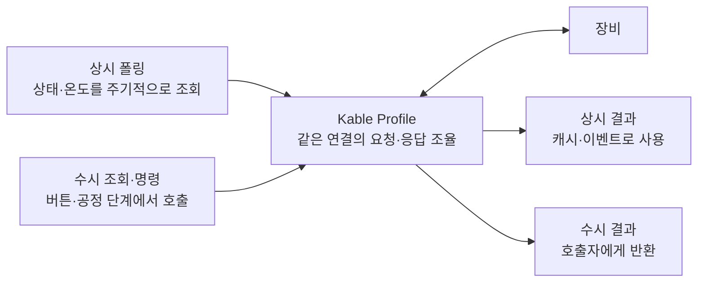

# Kable · 상시 폴링은 등록하고, 수시 조회는 호출하세요

**명령과 간격을 등록하면 Kable이 반복 조회·응답 조율·최신값 보관을 관리합니다.**
.NET 8 · .NET 10 · netstandard2.0용 비동기 장비 통신 라이브러리입니다.



| 하고 싶은 일 | 앱에서 작성할 내용 | Kable 기능 |
| --- | --- | --- |
| 상태를 계속 읽기 | 항목·명령·간격 등록 | `AddPeriodic` 자동 반복 |
| 필요할 때 한 번 조회하기 | 수시 명령 등록·호출 | `AddAperiodic` + `ExecuteAsync` |
| 화면에서 최신값 사용하기 | 허용할 데이터 나이 지정 | `TryGetFresh` 캐시 조회 |

[상시·수시 동작을 흐름도로 보기](WHY_KABLE.md) · [기본 .NET API로 직접 구성할 영역 비교](WHY_KABLE.md#기본-net-api로-같은-기능을-만들면)

## 폴링과 수시 조회를 함께 구성

프로젝트 폴더에서 `dotnet add package Kable`을 실행합니다.
다음은 .NET 8/10 콘솔 예제입니다. 주소·명령은 장비 사양에 맞게 바꿉니다.

```csharp
using Kable.Engine.Profiles;

var config = new KableProfileConfig<PeriodicItem, OnDemandCommand>()
    .UseTcp("192.168.0.100", 9000)
    .AddPeriodic(PeriodicItem.Status, "STATUS?", TimeSpan.FromSeconds(1))
    .AddPeriodic(PeriodicItem.Temperature, "TEMP?", TimeSpan.FromMilliseconds(500))
    .AddAperiodic(OnDemandCommand.ReadModel, "MODEL?");

await using var device = await KableProfileManager.ConnectAsync(config);

string model = await device.ExecuteAsync(OnDemandCommand.ReadModel);
Console.WriteLine(model);

await Task.Delay(TimeSpan.FromSeconds(10));
if (device.TryGetFresh(PeriodicItem.Status, TimeSpan.FromSeconds(3), out var status))
    Console.WriteLine(status);

enum PeriodicItem { Status, Temperature }
enum OnDemandCommand { ReadModel }
```

상시는 연결 후 자동 반복하고, 수시는 호출할 때 한 번 실행합니다.
예제의 10초는 데모 유지 시간입니다. 첫 응답이 없거나 캐시가 오래되면 `TryGetFresh`는 false입니다.

## 목적에 맞게 시작하기

| 목적 | 진입점·가이드 |
| --- | --- |
| 문자열 명령 한 번 보내기 | [KableSimple 시작 가이드](GETTING_STARTED.md) |
| 상시·수시 조회와 캐시 | [Profile 컨셉과 예제](WHY_KABLE.md) |
| 바이너리·장비 전용 프레임 | [Builder와 코덱](DEVELOPER_USAGE.md) |
| Modbus·MELSEC·프로토콜 확장 | [지원 기능과 사용법](SOFTWARE_HARDENING_USAGE.md) |
| 자동 재연결 | [ReconnectingKableClient 사용법](ERROR_HANDLING.md#선택적-자동-재연결) |
| 다중 클라이언트 서버 | [서버 호스팅](SERVER_HOSTING.md) |

## 다음 단계

[설치·지원 환경](RELEASE_GUIDE.md) · [설정과 이벤트](DEVELOPER_USAGE.md) ·
[오류 처리와 종료](ERROR_HANDLING.md) · [세션 수명](CONNECTION_LIFECYCLE.md)

[성능 비교](benchmarks/LibraryComparison.md) · [오류 처리 검증](benchmarks/FaultComparison.md) ·
[1.10.1 릴리즈 노트](/releases/1.10.1.ko.md) · [GitHub 저장소](https://github.com/Johnny-HW/Kable)
