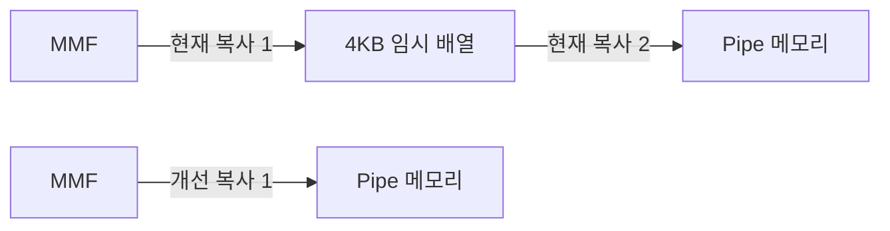
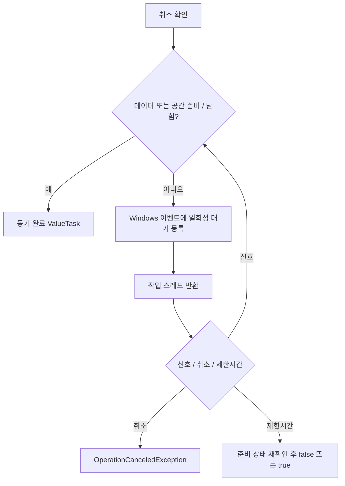

# 공유 메모리 수신 복사·비동기 대기 상세 설계

작성일: 2026-10-27. 승인 범위: 재검토 보고서의 1번 중간 복사 제거, 2번 비동기 대기.
이번 요청을 상세 설계·테스트·해당 범위 구현 승인으로 적용한다.
기준은 PROJECT_SPEC, SYSTEM_DESIGN, CONVENTIONS 및 CONNECTION_LIFECYCLE이다.

## 1. 범위와 불변식

- Transports → Codecs → Engine 경계를 유지한다. IConnectionContext/IProtocolCodec 변경 없음.
- FIFO/CID·긴급 명령·알람·UI·PCAP·파형 버퍼·바이너리 메시지 소유권 변경 없음.
- 데이터를 모으는 대기, 알림 생략, 새로운 배치 정책을 도입하지 않는다.
- MMF의 SPSC 계약과 헤더/커널 객체 이름을 유지한다.
- 수신은 최대 4096바이트씩 읽고 실제 읽은 양만 Advance, 매 성공 읽기 후 FlushAsync한다.
- 종료 후 Read/Write는 0, IsClosed는 true. 메모리 해제와 포인터 접근이 겹치지 않아야 한다.

## 2. 단계 A: 직접 수신

PumpInboundAsync가 writer.GetMemory(4096)로 버퍼를 확보한 뒤 첫 4096바이트를
SharedMemoryRingBuffer.Read에 전달한다. 0바이트이면 Advance하지 않고 다음 수신을 기다린다.
Span은 동기 Read 호출 안에서만 사용하고 await 경계를 넘기지 않는다.
기존의 임시 배열은 펌프당 1회 할당이었다. 제거 효과를 메시지당 4KB로 계산하지 않는다.

검증은 기존 구현에서 같은 통합 테스트를 먼저 실행한 뒤 변경 후 재실행한다.
성능 검증은 동일한 MMF/출력 버퍼를 재사용하여 기존 두 번 복사와 직접 복사를 비교한다.
전체 통신이 몇 배 빨라진다는 주장을 하지 않는다.

## 3. 단계 B: Windows 이벤트 비동기 대기

- 기존 동기 WaitForData/WaitForSpace API를 유지한다.
- WaitForDataAsync/WaitForSpaceAsync를 별도 편의 API로 추가한다.
  인자: timeoutMs=-1, CancellationToken ct=default. -1 무제한, 0 즉시 확인, -1 미만 오류.
- 준비 상태 또는 닫힘이면 true, 제한시간 동안 준비되지 않으면 false, 취소 시 취소 예외.
- 이벤트는 준비 상태 자체가 아닌 힌트다. 남아 있던 신호는 상태 재확인 후 다시 기다린다.
- ThreadPool.RegisterWaitForSingleObject의 일회성 등록을 사용한다. Task.Run 안의 동기 대기로 대체하지 않는다.
- 이벤트는 AutoResetEvent를 그대로 사용한다. 게시마다 Set하며, 빈→비어있지 않음 알림 축소는 하지 않는다.
  상태 확인과 등록 사이에 도착한 신호는 커널 이벤트에 남으므로 등록 후 소비된다.
- 데이터/공간 대기는 방향별 하나만 허용한다. 같은 방향의 중복 대기는 명시적 오류로 거절한다.
  SPSC에서 동일 신호를 여러 대기자가 경쟁 소비하는 모호성을 방지한다.
- 비동기 콜백은 TaskCompletionSource만 완료하고 사용자 코드를 직접 실행하지 않는다.
  RunContinuationsAsynchronously로 이벤트 콜백과 처리 루프를 분리한다.
- 취소는 해당 대기만 취소한다. 공유 커널 이벤트를 취소용으로 Set하지 않는다.
- 완료 후 cancellation registration을 정리하고 registered wait를 Unregister한다.
  늦게 실행된 콜백은 TCS.TrySet 계열만 호출하며 MMF/이벤트에 접근하지 않는다.
- 빠른 준비 경로는 할당 없는 ValueTask. 실제 비동기 대기 경로에는 TCS·등록 등의 할당이 있다.
  무할당 수신 처리와 별도로 측정하며, 복잡한 대기 객체 풀링은 이번 범위에 넣지 않는다.

펌프는 무제한 비동기 대기를 사용한다. 기존 50ms 재확인 폴링을 없애고 취소/Close 신호로 깨어난다.
상대방이 Close/Dispose를 수행하는 협력적 종료를 대상으로 한다.
상대 프로세스 강제 종료 감지를 MMF만으로 보장하는 새로운 heartbeat는 추가하지 않는다.

## 4. 수명 및 종료

기존 active I/O 카운터 앞의 포인터 읽기와 대기 중 Dispose는 해제 경합 위험이 있다.
이를 승인 범위의 안전성 선행 작업으로 같이 처리한다.

- 하나의 원자적 수명 상태에 닫힘 비트와 진행 중 접근 수를 함께 보관한다.
- 포인터/이벤트에 접근하기 전 CAS로 접근권을 확보한다. 닫힘 비트가 있으면 진입하지 않는다.
- Dispose는 접근권을 가진 상태에서 닫힘 비트를 게시하고 공유 헤더를 닫고 두 이벤트를 깨운다.
- 이미 진입한 읽기·쓰기·대기는 끝날 때 접근권을 반환한다.
- 마지막 접근권 반환자가 포인터·뷰·MMF·이벤트를 해제한다.
  Dispose가 스레드를 붙잡고 진행 작업 종료를 spin-wait하지 않는다.
- 닫힘 게시 후 신규 접근은 실패하므로 마지막 접근권 반환과 새 포인터 접근이 교차하지 않는다.
- 대기 진입부터 await 완료 및 등록 해제까지 접근권을 유지한다.
- MMF 헤더의 IsClosed는 같은 매핑을 연 상대 endpoint에도 보인다.

동기 Dispose는 닫힘을 즉시 게시하되 진행 작업이 있으면 실제 핸들 해제를 마지막 작업에 위임한다.
컨텍스트 DisposeAsync는 취소 → 두 링 닫힘 → 펌프 종료 await → 링 Dispose 순서다.
동시 DisposeAsync 호출자는 같은 완료 작업을 공유한다.
수신/송신 펌프 종료는 연결 종료 토큰과 반대 펌프에도 전달하고 Pipe는 해당 완료/오류를 전달한다.
버퍼가 닫힌 상태에서 송신 내부 루프가 0바이트 쓰기를 무한 반복하지 않도록 종료 조건을 확인한다.

## 5. 파일 구성

새 파일과 수정 후 파일은 각각 300줄 미만으로 유지한다.

| 책임 | 파일 |
| --- | --- |
| 직접 수신 및 펌프 연결 | src/Kable.SharedMemory/SharedMemoryConnectionContext.cs 및 필요 시 partial |
| MMF 생성/열기 | src/Kable.SharedMemory/Memory/SharedMemoryRingBuffer.cs |
| MMF 헤더 | src/Kable.SharedMemory/Memory/MmfRingBufferHeader.cs |
| 읽기·쓰기 | src/Kable.SharedMemory/Memory/SharedMemoryRingBuffer.IO.cs |
| 접근권·닫힘·해제 | src/Kable.SharedMemory/Memory/SharedMemoryRingBuffer.Lifetime.cs |
| 동기/비동기 조건 대기 | src/Kable.SharedMemory/Memory/SharedMemoryRingBuffer.Waiting.cs |
| 이벤트 일회성 비동기 어댑터 | src/Kable.SharedMemory/Memory/RegisteredEventWait.cs |
| 전송 통합 테스트 | tests/Kable.SharedMemory.Tests/Transports/ |
| 독립 프로세스 IPC 테스트 호스트 | tests/Kable.SharedMemory.TestPeer/ |
| 대기·종료·경합 테스트 | tests/Kable.SharedMemory.Tests/Memory/ |
| 독립 Windows 성능 비교 | tests/Kable.SharedMemory.Benchmarks/ |

## 6. 테스트 계획과 합격 기준

### 데이터/전송

- 1/64/4095/4096/4097/65536바이트 및 1MiB, 바이트별 패턴 동일성.
- 작은 링의 반복 wrap-around, 여러 세그먼트, 한 바이트씩 단편화.
- 양방향 동시 전송, 수신 소비자 지연, Pipe/링 backpressure.
- 유휴·수신 Flush 대기·송신 링 포화 중 Abort/DisposeAsync 종료.
- 상대 endpoint 종료가 Input/ConnectionClosed에 전달되는지 확인.
- 독립 dotnet 프로세스 사이 1바이트/1MiB 왕복과 협력적 종료를 확인.
- 임의 추가 메시지 축적이 없고 1바이트도 즉시 전달되는지 확인.

### 대기/수명

- 준비 시 동기 완료, 빈 데이터/가득 찬 공간에서 대기, 게시/소비 후 재개.
- 남아 있는 이벤트 신호, 0/유한/무제한 timeout, 잘못된 timeout.
- 호출 전/등록 중/대기 중 취소, 취소 후 다음 대기의 정상 동작.
- 같은 방향 중복 대기 오류, 반대 방향 독립성.
- 상대 Close와 로컬 Dispose가 두 방향 대기를 종료.
- 상태 확인 직후 게시하는 반복 경합, 신호·취소·Dispose 경쟁.
- IsClosed/Read/Write/Close/Wait와 Dispose의 동시 실행 및 반복 Dispose.
- 여러 endpoint가 대기해도 대기별 전용 ThreadPool 작업을 점유하지 않는지 구조·부하 검증.

### 실행과 판정

- 먼저 테스트 작성 및 변경 전 결과 기록. 새 API 테스트는 API 추가 전 컴파일 실패가 정상이다.
- Release의 공유 메모리 전체 테스트 및 해당 변경과 연결된 Kable 엔진 회귀 테스트.
- 의미 있는 경합 반복은 별도 반복 실행하고 프로세스 실패/타임아웃도 실패로 취급한다.
- 단순히 테스트 개수를 늘리기보다 신호/취소/종료 교차 상황별로 검증한다.
- 성능은 처리량·할당·스레드 증가·유휴 CPU를 구분한다. 환경 의존 수치에 임의의 합격 임계값을 넣지 않는다.
- 복사 제거는 대상 비용 감소, 비동기 대기는 점유 대기 제거 및 종료 정합성을 확인한다.
- 실장비 p99, 다중 프로세스 강제 종료, 파형·UI·PCAP 성능을 검증했다고 주장하지 않는다.

검증된 단계별로 이번 변경 파일만 커밋한다. 기존 사용자 변경을 reset하거나 함께 커밋하지 않는다.
실행 결과와 남은 한계는 별도 SHARED_MEMORY_OPTIMIZATION_RESULTS.md에 기록한다.
