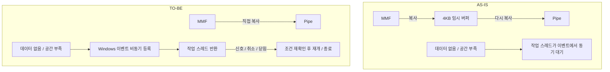

# 공유 메모리 최적화 설계·구현·검증 결과

검증일: 2026-10-27. 대상: 승인된 중간 복사 제거와 비동기 이벤트 대기.
상세 계약·흐름도·대상 파일은 [상세 설계](SHARED_MEMORY_OPTIMIZATION_DESIGN.md)를 참조한다.

## 1. 결과 요약

| 항목 | 결과 | 해석 |
| --- | --- | --- |
| 수신 중간 버퍼 | 제거 | MMF → Pipe 메모리로 직접 복사. 처리 단위 최대 4096B와 매 성공 읽기 후 flush 유지 |
| 비동기 대기 | 적용 | 유휴/포화 시 Windows 이벤트 등록 후 await. 연결 펌프의 50ms 동기 재대기 제거 |
| 메모리 수명 | 보강 | 닫힘 비트와 접근 수를 원자적으로 관리해 마지막 접근 종료 후 자원 해제 |
| 상대방 종료 | 보강 | 반대 펌프와 ConnectionClosed로 전파. 대기 중 송신 루프도 종료 |
| 동시 DisposeAsync | 완료 공유 | 호출자들이 동일 종료 작업을 기다림 |
| 공유 메모리 테스트 | 67개 | 기존 7개 + 이번에 추가한 60개(Theory 입력별 실행 포함) |
| 기본 Kable 회귀 테스트 | 355개 통과 | 현재 작업 트리 기준. 엔진 외 기존 테스트도 포함 |
| 복사 성능 | 작은 평균 차이 | 큰 체감 성능 향상이나 확정적인 개선율을 주장하지 않음 |
| 다중 유휴 대기 | 스레드 점유 감소 확인 | 128개 대기에서 약 129개 작업 스레드 점유가 약 2개로 감소한 측정 사례 |
| 비동기 대기 비용 | 실제 대기에는 할당 존재 | 준비된 빠른 경로와 구분해야 함. 아래 할당 측정 참조 |

코덱 ToArray, 배치·알림 축소, UI·PCAP·파형 버퍼 및 FIFO/CID 정책은 변경하지 않았다.
기존 작업 트리의 다른 변경을 초기화하거나 이번 커밋에 포함하지 않았다.

## 2. AS-IS / TO-BE



중간 버퍼는 기존에도 펌프당 한 번만 할당됐다. 절감 핵심은 매 수신의 중간 복사다.
비동기화는 스레드 점유를 줄이는 변경이며 각 메시지 처리 시간을 항상 단축하는 변경은 아니다.

## 3. TDD 및 실패 확인 기록

1. 변경 전 기존 공유 메모리 테스트 7개 통과.
2. 직접 수신용 10개 테스트를 먼저 추가하여 기존 구현에서 통과 확인.
   바이트 내용·순서·압력 정책의 기준선을 잡은 다음 복사 제거 후 17개 전체 통과.
3. 비동기 대기 테스트를 먼저 추가했을 때 신규 API 미구현 컴파일 오류 확인.
4. 상대 Dispose 후 Input은 끝나도 ConnectionClosed가 취소되지 않는 기존 동작을
   테스트로 재현: 5초 내 취소 기대에 TimeoutException 발생.
5. 비동기 대기·수명 보호·종료 전파 적용 후 대기·경합·전송 테스트 통과.
6. 긴 전송 검증에서 AdvanceTo 이후 buffer.Length를 다시 확인하던 새 구현을 수정했다.
   Pipe가 재사용할 수 있으므로 필요한 상태는 AdvanceTo 전에 계산한다.
7. 반복 검증에서 “포화 중 종료되면 FlushResult가 항상 취소/완료 표시를 가진다”는
   테스트 가정이 틀림을 확인했다. Flush는 reader 진행으로도 완료될 수 있다.
   테스트를 대기 해제와 ConnectionClosed 전달 검증으로 수정했고, 송신 성공 응답으로 해석하지 않는다.
8. 독립 프로세스 IPC 및 Pipe 입출력 오류 주입 테스트를 추가해 전체 67개를 검증했다.

## 4. 테스트 범위

| 영역 | 검증 내용 | 주요 파일 |
| --- | --- | --- |
| 수신 정확성 | 1/64/4095/4096/4097/65536B 및 1MiB, 작은 링 순환, 여러 chunk | InboundCopyTests |
| 양방향·압력 | 동시 상하향 스트림, 소비 지연 후 전량 복구 | InboundCopyTests |
| 준비·대기 | 동기 완료, 데이터 도착/공간 해소, 0/유한/무제한 제한시간, 잘못된 인자 | RingBufferWaitTests |
| 신호 정합성 | 남은 이벤트 신호를 준비 상태로 오인하지 않음, 등록과 게시 경합 | RingBufferWaitTests / RingBufferRaceTests |
| 취소 | 호출 전/대기 중 취소, 토큰 보존, 다음 대기 재사용 | RingBufferWaitTests / RingBufferLifetimeTests |
| 대기자 정책 | 같은 방향 중복 대기 거절, 반대 방향 독립성 | RingBufferWaitTests / RingBufferLifetimeTests |
| 수명 | 진행 I/O/IsClosed와 Dispose 경쟁, 반복 Dispose/Close, 해제 후 안전한 API 결과 | RingBufferRaceTests / RingBufferLifetimeTests |
| 연결 종료 | 유휴·송신 포화 중 Abort/Dispose, 동시 종료 8개 호출자 | TransportLifecycleTests |
| 연결 규모 | 서버/클라이언트 64쌍 생성·전송·종료 | TransportLifecycleTests |
| 상위 세션 | 상대 종료 시 대기 요청이 30초 timeout 대신 단절 예외로 끝남 | TransportCancellationTests |
| 읽기 취소 | 호출자 ReadAsync 취소 후 같은 연결에서 다음 수신 성공 | TransportCancellationTests |
| 실제 IPC | 별도 dotnet 프로세스와 1B/1MiB 왕복 및 협력적 종료 | CrossProcessTransportTests / TestPeer |
| 오류 주입 | 입력 소비자 완료, 출력 IOException 후 양 endpoint 종료 | TransportFaultTests |
| 빠른 경로 할당 | 준비된 비동기 대기 10000회, 현재 스레드에서 관측 할당 0B | RingBufferLifetimeTests |

최종 전체 67개 테스트를 별도 테스트 프로세스로 10회 연속 실행해 670개 실행이 모두 통과했다.
각 실행에는 등록/게시 경합 600회, 신호/취소/Dispose 경쟁 400회, 접근/Dispose 경쟁 100회가 포함된다.
따라서 10회 반복에서는 위 경쟁 시나리오를 총 11000회 수행한다.
확률적 반복은 모든 스케줄 순서를 증명하는 형식 검증은 아니다.

## 5. 복사 비교 측정

환경: Windows 11 23H2, Intel Core 7 150U, .NET SDK 10.0.301 / Runtime 10.0.9 x64 AVX2.
Release, BenchmarkDotNet 0.14.0, 프로세스 2회, 워밍업 3회, 측정 5회, 반복 목표 250ms.
측정 한 호출에서 256번 수행하고 작업당 환산한다.

| 크기 | 임시 버퍼 경유 | 직접 수신 | 평균 비율 |
| --- | --- | --- | --- |
| 64B | 253.8ns ± 11.33ns | 248.0ns ± 14.44ns | 0.98 |
| 4096B | 325.5ns ± 15.25ns | 302.8ns ± 17.84ns | 0.93 |

±는 BenchmarkDotNet의 99.9% 신뢰구간 반폭이다. 구간이 겹치고 이상치 제거가 있어
“2%/7% 확정 개선”이라고 해석하지 않는다. 같은 세션의 다른 검증 부하 영향 가능성도 있다.
두 경로 모두 현재 수명 보호와 이벤트 Set을 사용하고 송신+수신을 포함한다.
이 비교는 추가 복사만 분리한 것이며, 과거 전체 버전 대 현재 전체 버전 비교가 아니다.
두 경로 모두 작업당 관리 할당은 관측되지 않았다. 임시 배열도 setup에서 재사용했다.
큰 성능 이득보다 불필요한 운반 단계 제거라는 구조적 이점이 확인된 상태다.

원본 요약: [SharedMemoryCopyBenchmarks](benchmarks/SharedMemoryCopyBenchmarks.md).

## 6. 비동기 대기의 스레드·할당 비용

독립 프로세스에서 유휴 상태의 단방향 링 대기 1/32/128개를 각각 생성했다.
기존 동기 점유 형태는 Task.Run 안에서 무제한 동기 대기로 재현했다.
동기 기준선도 폴링하지 않으므로 CPU 이득을 과장하지 않는다.
모든 동기 대기가 시작되도록 두 방식 모두 최소 작업 스레드 수를 max(기존, 대기 수+8)로 설정했다.
100ms 안정화 후 500ms 관측한다. 일반 앱 기본 ThreadPool 설정의 자동 확장 속도를 측정한 것은 아니다.

| 대기 수 | 동기 작업 스레드 점유 증가 | 비동기 작업 스레드 점유 증가 | 동기/비동기 전체 프로세스 스레드 |
| --- | --- | --- | --- |
| 1 | 2 | 2 | 13 / 13 |
| 32 | 34 | 1 | 48 / 12 |
| 128 | 129 | 2 | 141 / 15 |

점유 증가에는 측정용 continuation 등이 포함돼 1~2개 차이가 생긴다.
Windows/.NET의 공유 이벤트 감시 스레드도 존재하므로 “스레드가 전혀 필요 없다”는 뜻이 아니다.
500ms CPU 측정은 타이머 해상도와 잡음 영향이 커 CPU 사용률/전력 개선 근거로 쓰지 않는다.

대기 비용은 별도 프로세스에서 500회 워밍업 후 10000회 측정했다.

- 준비된 대기: 전체 프로세스 기준 약 0.0128B/회 관측(다른 런타임 작업 잡음 포함).
  단위 테스트의 현재 스레드 기준 10000회는 0B였다.
- 미준비 상태에서 등록 → 게시 → callback 재개 → 읽기: 약 688.52B/회 관리 할당 관측.
- 해당 등록/재개 왕복 평균 약 15.71µs. 장비 왕복 지연이나 p99가 아니다.

실제 대기에는 TCS, 등록, 비동기 continuation 비용이 있다.
따라서 다중 유휴 연결의 스레드 절약과 고빈도 대기의 할당 부담을 함께 고려해야 한다.
이미 데이터가 준비된 경우에는 이 등록 경로를 타지 않는다.
대기 빈도가 높은 실제 부하의 장시간 GC/p99 검증 없이 범용 무할당 개선으로 홍보하지 않는다.

## 7. 커버리지와 검증 한계

Release 기본 설정은 심볼 생성을 끄고 참조 심볼도 복사하지 않아 최초 수집은 빈 결과였다.
프로젝트 파일을 바꾸지 않고 테스트 명령에서 portable PDB와 참조 PDB 복사를 활성화해 수집했다.
65개 테스트 시점의 Kable.SharedMemory 패키지: 라인 91.92%, 분기 83.33%.
링 I/O·수명 보호 및 이벤트 어댑터는 라인 100%, 대기 파일도 라인 100%였지만
대기 분기는 약 87.5~90.62%로 일부 미실행 경로가 있다.
이 수치는 마지막 오류 주입 2개를 추가하기 전의 스냅샷이며 최종 67개 커버리지라고 주장하지 않는다.
파형 기존 코드도 패키지 통계에 포함된다. 커버리지는 경합 안전성의 증명이 아니다.

남은 한계:

후속 운영 적합성·우선순위 평가는 [잔여 항목 평가](SHARED_MEMORY_OPERATIONAL_ASSESSMENT.md)를 참조한다.

- 실장비와 장시간 운영, 실제 부하의 p99/GC 중단시간은 측정하지 않았다.
- MMF는 협력적 Close/Dispose를 신호로 사용한다. 상대 프로세스 강제 종료에 대한 자동 감지는 추가하지 않았다.
- 프로세스 간 단일 생산자/소비자 계약을 유지한다. 임의 다중 작성자·읽기자 지원은 아니다.
- 동기 API의 이벤트 준비 상태 재확인은 남은 신호 때문에 발생하던 가짜 readiness를 줄인다.
  같은 방향의 중복 대기는 명시적 오류이므로 해당 사용 방식이 있으면 수정이 필요하다.
- Dispose는 진행 작업이 있으면 마지막 접근 종료 시 실제 자원을 해제한다.
  진행 중 작업을 기다리는 호출자는 Wait 완료 또는 컨텍스트 DisposeAsync를 await해야 한다.
- 새 비동기 대기의 할당 축소를 위한 객체 풀링은 이번 범위에서 구현하지 않았다.
- MMF 생성 실패/손상된 외부 헤더 등 기존 생성 경로의 완전한 자원 감사는 별도 과제다.

## 8. 재현 명령

저장소 루트에서 실행한다. 벤치마크는 솔루션 설정을 건드리지 않는 별도 Windows 프로젝트다.

```powershell
dotnet test tests/Kable.SharedMemory.Tests/Kable.SharedMemory.Tests.csproj -c Release
dotnet test tests/Kable.Tests/Kable.Tests.csproj -c Release
dotnet run --project tests/Kable.SharedMemory.Benchmarks/Kable.SharedMemory.Benchmarks.csproj -c Release -- --filter '*InboundCopyBenchmarks*' --artifacts artifacts/shared-memory-review/copy-bench
dotnet run --project tests/Kable.SharedMemory.Benchmarks/Kable.SharedMemory.Benchmarks.csproj -c Release -- --idle sync 128
dotnet run --project tests/Kable.SharedMemory.Benchmarks/Kable.SharedMemory.Benchmarks.csproj -c Release -- --idle async 128
dotnet run --project tests/Kable.SharedMemory.Benchmarks/Kable.SharedMemory.Benchmarks.csproj -c Release -- --wait-cost 10000
dotnet test tests/Kable.SharedMemory.Tests/Kable.SharedMemory.Tests.csproj -c Release -p:DebugSymbols=true -p:DebugType=portable -p:AllowedReferenceRelatedFileExtensions=.pdb --collect 'XPlat Code Coverage' --results-directory artifacts/shared-memory-review/coverage-complete
```

세션 실행 로그와 JSON 관측값은 artifacts/shared-memory-review/에 보관했다(로컬, Git 제외).
각 재현 실행은 CPU·스레드 수·할당의 관측값이 달라질 수 있다.

## 9. 계약 확인 자료

- [RegisterWaitForSingleObject 공식 문서](https://learn.microsoft.com/en-us/dotnet/api/system.threading.threadpool.registerwaitforsingleobject): 신호/제한시간 callback 및 사용 후 Unregister 계약.
- [Unregister 공식 문서](https://learn.microsoft.com/en-us/dotnet/api/system.threading.registeredwaithandle.unregister): 등록 해제와 실행 중 callback의 관계.
- 이번 callback은 TCS만 완료한다. 늦은 callback이 MMF나 이벤트에 다시 접근하지 않도록 했다.
