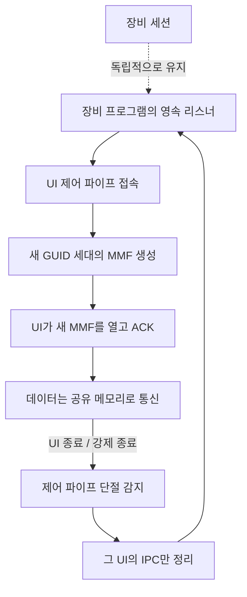

# 장비 연결을 유지하는 UI 재접속 사용법

SharedMemoryServerListener와 SharedMemoryClientFactory는 UI IPC의 수명을 장비 연결과 분리한다.
UI 프로세스가 중단돼도 서버 프로그램과 그 서버가 소유한 장비 세션은 계속 유지할 수 있다.

## 1. 연결 흐름



논리 채널 이름은 같아도 매 접속의 실제 MMF 이름은 다르다.
이전 MMF 참조가 다른 객체에 남아 있어도 새 연결의 버퍼를 덮어쓰지 않는다.
동일 물리 이름에 대한 중복 Create는 실패한다. 기존 채널을 초기화하지 않는다.

## 2. 공개 API

```csharp
using Kable.SharedMemory.Connections;

await using var listener = new SharedMemoryServerListener("device-ui");
var factory = new SharedMemoryClientFactory("device-ui");
```

서버는 AcceptAsync, UI는 ConnectAsync를 호출한다. 반환 타입은 IConnectionContext이다.
서버 앱은 UI 연결이 끝난 후 AcceptAsync를 다시 호출하는 루프를 유지해야 한다.
리스너가 장비 요청 처리나 UI 연결별 작업을 자동으로 시작하는 것은 아니다.

- 기본 MMF 용량: 65536B. 서버 생성자의 bufferCapacityPowerOfTwo로 지정한다.
- 기본 connect/handshake 제한시간: 각각 5000ms. 각 생성자 인자로 변경할 수 있다.
- 관리형 연결의 SharedMemoryConnectionContext.SessionGeneration은 양쪽에서 같은 GUID이다.
- 한 논리 채널에 활성 UI는 하나다. 두 번째 접속은 기존 UI를 추방하지 않고 연결 제한시간 내 대기한다.
- 논리 채널의 중복 리스너는 IOException으로 실패한다.
- 제어 파이프는 현재 Windows 사용자만 허용한다. 다른 계정의 서비스 접속 정책은 별도 설계가 필요하다.

## 3. 장비 세션을 소유하지 않는 상위 앱 예제

완전한 컴파일 대상은 `samples/Kable.SharedMemory.Reconnect/UiReconnectExample.cs`이다.
호스트 메서드는 이미 시작된 IDeviceSession<string>을 받아 사용하며 이를 Dispose하지 않는다.

```csharp
using Kable.Engine;
using Kable.Samples.SharedMemoryReconnect;

public static class Usage
{
    public static Task RunServerAsync(IDeviceSession<string> device, CancellationToken stop)
        => UiReconnectExample.RunHostAsync(device, "device-ui",
            error => Console.Error.WriteLine(error.Message), stop);

    public static async Task ShowUiStatusAsync(CancellationToken stop)
    {
        var connected = await UiReconnectExample.OpenUiAsync("device-ui", stop);
        await using var uiSession = connected.Session;
        Console.WriteLine(connected.InitialState);
    }
}
```

ShowUiStatusAsync는 상태를 출력한 뒤 연결을 종료하는 작은 예제다.
실제 UI는 화면/앱 수명 동안 반환받은 Session을 유지하고 앱 종료 시 DisposeAsync한다.
STATUS는 샘플 앱의 현재 상태 조회 명령이며, 라이브러리가 특정 장비의 상태 프로토콜을 강제하지 않는다.

UI 재실행 시 새 세션을 만들고 상태를 다시 조회한다.
실패한 이전 명령을 라이브러리가 자동으로 재전송하지 않는다.

## 4. 명령 처리 시 지켜야 할 수명

1. UI 요청을 꺼낸 뒤 장비로 송신하기 전에 원래 IPC가 닫혔는지 확인한다.
2. 송신된 장비 명령에는 장비 작업의 timeout/호스트 종료 토큰을 적용한다.
   UI 단절 토큰을 장비 FIFO 요청 취소에 직접 연결하면 장비 세션 종료 계약이 발동할 수 있다.
3. 장비가 응답해도 요청한 UI가 끝났으면 그 UI로의 응답은 폐기한다.
4. 늦은 응답을 전역 “현재 UI 연결”로 보내지 않는다. 원래 연결 객체에만 응답한다.
5. 새 UI는 현재 상태를 새로 조회하고 실행 결과가 불명확한 명령을 맹목적으로 재전송하지 않는다.

transport는 이전 MMF 바이트를 격리하지만 이미 앱 처리 큐에 올라간 작업을 대신 취소하지 않는다.
샘플과 UiRestartProcessTests는 장비 명령 진행 중 UI를 강제 종료해도 같은 장비 세션과 명령 1회를 유지하는 예다.

## 5. 오류·종료·기존 API

- 호출자 취소: OperationCanceledException. connect/handshake 제한시간: TimeoutException.
- 잘못된 제어 frame: InvalidDataException. 중도 단절: IOException 계열.
- 서버의 연결 준비 실패는 임시 세대만 정리한다. 앱은 오류를 기록하고 다음 AcceptAsync를 호출할 수 있다.
- UI의 정상 종료/프로세스 강제 종료는 제어 파이프 단절로 해당 IPC의 ConnectionClosed에 전달된다.
- 살아 있지만 멈춘 UI의 hang을 자동 탐지하는 heartbeat는 추가하지 않았다.
- DisposeAsync는 해당 IPC를 종료하며 장비 세션이나 상대 프로세스를 종료하지 않는다.
- DisposeAsync 완료는 장비 명령 성공/상대방 데이터 기록 완료의 보장이 아니다.

기존 SharedMemoryTransport.CreateServerEndpoint/ConnectClientEndpoint는 저수준 물리 채널 API로 남는다.
이 API만 사용하던 앱은 자동으로 새 재접속 기능을 얻지 않는다. 관리형 리스너/팩토리로 연결 경로를 바꿔야 한다.
기존 물리 채널 생성은 이제 덮어쓰기 대신 실패하고, 손상된 헤더 및 닫힌 채널의 Open은 거절된다.

실행 결과와 성능 장단점은 [재접속 검증 결과](SHARED_MEMORY_RECONNECTION_RESULTS.md)를 참조한다.
