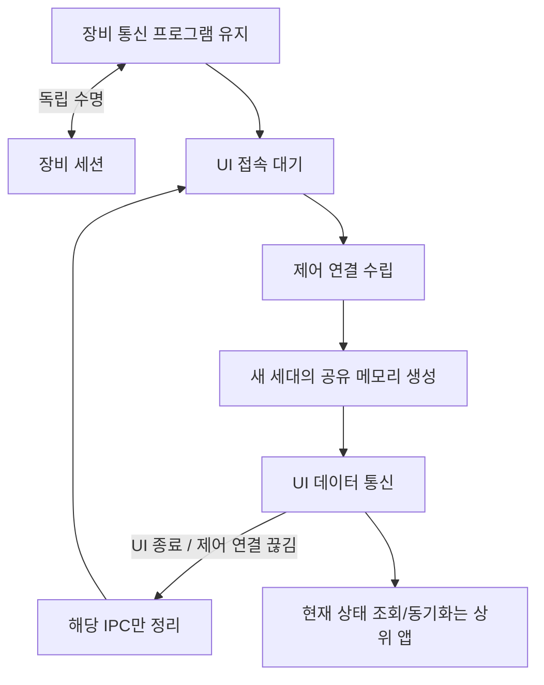

# 장비 연결을 유지하는 UI 공유 메모리 재접속 계획

작성일: 2026-10-27. 사용자 승인: 계획 문서 반영 후 작업 시작.
기존 [운영 평가](SHARED_MEMORY_OPERATIONAL_ASSESSMENT.md)의 후속 실행 계획이다.
“양쪽 프로그램/장비 연결을 종료해야 재시작 가능”한 흐름으로 구현하지 않는다.

## 1. 목표와 동작

장비 통신 프로그램은 실행 상태와 장비 세션을 유지한다.
UI가 정상 종료·강제 종료된 뒤 재실행되면 동일 논리 채널로 접속할 수 있어야 한다.
이전 UI의 공유 메모리·미수신 데이터·늦은 응답을 새 UI 연결에 재사용하지 않는다.

SPSC는 유지한다. 활성 UI가 있는데 다른 UI가 접속해도 기존 연결을 강제로 교체하지 않는다.
논리 채널은 재사용하지만, 물리 MMF 이름은 접속마다 GUID로 달라진다.
기존 MMF를 초기화해서 재사용하는 방식과 구분한다.

## 2. 공개 API와 계층

- 기존 SharedMemoryTransport.CreateServerEndpoint/ConnectClientEndpoint는 저수준 API로 유지한다.
  물리 이름이 이미 존재하면 Create는 실패하며 이전 헤더를 변경하지 않는다.
  이 두 메서드만 사용하는 기존 앱에 자동 재접속/프로세스 감시가 생기는 것은 아니다.
- 새 SharedMemoryServerListener는 IConnectionListener를 구현한다.
  생성자: 논리 channelName, capacity=65536, handshakeTimeoutMs=5000.
  AcceptAsync는 새 IPC를 반환하며 다음 AcceptAsync는 기존 IPC 종료 뒤 다음 UI를 받는다.
- 새 SharedMemoryClientFactory는 IConnectionFactory를 구현한다.
  생성자: 논리 channelName, connectTimeoutMs=5000.
  ConnectAsync는 매번 새 IPC를 만든다. 자동 명령 재시도는 제공하지 않는다.
- SharedMemoryConnectionContext.SessionGeneration(Guid?)은 관리형 연결의 세대를 표시한다.
  저수준 연결은 null. IConnectionContext/IProtocolCodec/IDeviceSession 선언은 변경하지 않는다.
- 제어 경로는 로컬 비동기 NamedPipe이며 현재 Windows 사용자만 허용한다.
  다른 사용자 계정 서비스와의 연결은 기본 지원 범위에 넣지 않는다.
- 별도 프로젝트 의존성을 늘리지 않고 Kable.SharedMemory 안의 Connections/ 아래에 분리한다.

이 API는 UI↔장비 통신 프로그램 사이의 연결이다. 장비 연결 팩토리/세션을 소유하거나 Dispose하지 않는다.

## 3. 제어 연결과 재접속

- 논리 이름은 SHA-256으로 안정적인 커널 객체 이름에 대응시킨다.
  리스너 전용 소유 이벤트의 createdNew 결과로 중복 리스너를 거절한다.
  소유 이벤트는 UI에 전달하지 않으며 리스너 수명 동안만 유지한다.
- 제어 파이프 하나가 활성 UI 하나에 대응한다. 다음 접속을 받기 전에 이전 IPC를 정리한다.
- 클라이언트 요청은 magic/버전 8바이트, 서버 응답은 magic/버전/세대 GUID 24바이트로 고정한다.
  클라이언트는 해당 세대의 양방향 MMF를 연 뒤 1바이트 ACK를 전송한다.
  서버는 ACK 뒤 연결을 앱에 공개한다. 짧은 frame/잘못된 magic/버전/ACK는 오류다.
- 세대별 물리 이름은 논리 이름의 해시와 GUID로 구성한다. 서버만 생성하고 UI는 Open한다.
- 핸드셰이크 완료 후 제어 파이프는 연결 수명 감시에만 사용한다.
  EOF/오류는 해당 SharedMemoryConnectionContext.Abort로 전달한다.
  MMF의 read/write/세션 hot path에는 제어 frame을 섞지 않는다.
- 외부 Process 객체를 요구하지 않아 독립 실행 UI와 앱이 실행한 UI를 같은 방식으로 지원한다.
  살아 있지만 응답하지 않는 앱의 hang 탐지는 별도 heartbeat 정책이며 이번 기본 동작에 추가하지 않는다.
- 연결/핸드셰이크 timeout과 호출자 취소를 지원한다. 리스너 종료는 대기 Accept도 해제한다.
- 핸드셰이크 실패 시 해당 임시 파이프/새 매핑만 정리하고 다음 AcceptAsync 호출이 가능해야 한다.
- Stop/Dispose는 활성 IPC와 대기를 종료한다. 동시 DisposeAsync 호출은 완료 작업을 공유한다.

## 4. 이전 명령과 장비 수명

물리 MMF가 세대별로 다르므로 이전 UI의 바이트가 새 IPC 버퍼에 들어오지 않는다.
상위 앱은 요청 처리 작업이 캡처한 연결로만 응답하고, 전역 “현재 UI”에 이전 결과를 전송하지 않는다.
이미 상위 처리 큐로 꺼낸 요청까지 transport가 취소해 주는 것은 아니다.
앱은 장비 송신 전 원래 UI 연결의 유효성을 확인하고 미실행 요청을 폐기한다.

이미 장비로 송신된 명령은 UI 단절 때문에 재전송하지 않는다.
그 장비 작업의 자체 timeout·취소 계약은 유지하고 UI 전용 취소를 FIFO 장비 요청에 직접 연결하지 않는다.
실행 결과는 유지 중인 장비 상태에 반영하고, 새 UI는 새 요청으로 현재 상태를 동기화한다.
제품별 상태 snapshot 형식은 라이브러리 transport에서 새로 정하지 않는다.

## 5. MMF 생성/열기 안전성

- CreateOrOpen 대신 CreateNew로 중복 물리 이름 생성을 원자적으로 거절한다.
- 헤더는 256B와 버전 1을 유지한다. metadata를 채운 뒤 Magic을 마지막에 게시한다.
- Open은 포인터 역참조 전 뷰가 헤더보다 큰지 확인한다.
  Magic, Version, 양수 2의 거듭제곱 Capacity, Mask=Capacity-1,
  256+Capacity가 뷰 범위 안인지, 닫힘 상태를 검사한다.
- 손상 헤더는 InvalidDataException, 닫힌 링은 InvalidOperationException으로 거절한다.
- 자원 획득 단계별 소유자를 하나로 정하고 성공 때만 객체에 소유권을 이전한다.
  실패 시 이벤트/포인터/뷰/MMF를 정리하고 AcquirePointer와 ReleasePointer를 대응시킨다.
- endpoint의 두 번째 링 생성/열기 실패 시 첫 번째 링도 정리한다.
  Open 실패 정리는 기존 서버의 공유 IsClosed를 바꾸지 않는 로컬 자원 반환을 사용한다.
- 기존 지연 해제를 유지한다. 새 API에서도 제어 감시와 펌프 종료를 await한 뒤 정리한다.

## 6. 구현 단위와 파일

각 신규/수정 파일은 300줄 미만. 프로덕션/테스트 도메인 폴더를 대응시킨다.

| 단위 | 주요 파일/폴더 |
| --- | --- |
| 생성·검증·실패 정리 | src/Kable.SharedMemory/Memory/SharedMemoryRingBuffer*.cs, RingBufferResources.cs |
| endpoint 롤백 | src/Kable.SharedMemory/SharedMemoryTransport.cs |
| 제어 frame·명명 | src/Kable.SharedMemory/Connections/SharedMemoryHandshake.cs |
| 서버 accept와 수명 | src/Kable.SharedMemory/Connections/SharedMemoryServerListener*.cs |
| 클라이언트 연결 | src/Kable.SharedMemory/Connections/SharedMemoryClientFactory.cs |
| IPC 감시 | src/Kable.SharedMemory/SharedMemoryConnectionContext.Control.cs 및 Lifetime partial |
| 회귀·오류·재접속 테스트 | tests/Kable.SharedMemory.Tests/Memory/, Connections/ |
| 독립 프로세스 테스트 호스트 | tests/Kable.SharedMemory.TestPeer/ |
| 전체 경로 성능 | tests/Kable.SharedMemory.Benchmarks/ 및 로컬 비교 스크립트 |

원자적 단위별 TDD → 최소 구현 → 관련 빌드·테스트 → 커밋 순서로 진행한다.
기존 작업 트리 변경은 보존하고 이번 작업 파일만 커밋한다.

## 7. 테스트와 합격 기준

### 안전성

- 잘못된 버전/0·음수·비거듭제곱 용량/잘못된 마스크/짧은 뷰/닫힌 링 거절.
- 중복 Create 실패 뒤 기존 1B와 버퍼 위치 보존, 다른 용량으로 재생성 거절.
- 누락 이벤트와 두 번째 링 실패 뒤 기존 첫 링이 닫히지 않음.
- 생성 실패 후 정상 생성/열기 성공, 획득 단계별 자원 반환 확인.

### UI 재접속·수명

- 새 API의 양방향 전송, 세대 일치, 정상 종료 뒤 재접속, 이전 세대와 다른 물리 버퍼.
- UI 강제 종료 뒤 기존 IPC ConnectionClosed, 장비 역할의 독립 세션은 계속 동작.
- UI 재실행 뒤 새 IPC 연결 성공, 이전 데이터/늦은 응답이 새 연결로 전달되지 않음.
- 이전 UI가 링을 보유한 상태의 연결 교체도 세대 분리로 영향 없음.
- 활성 UI가 있을 때 두 번째 UI 접속이 기존 통신을 교체하지 않음.
- 잘못된/중도 종료 handshake, connect/accept 취소와 timeout 뒤 재시도 가능.
- 리스너 중복 생성, 유휴/포화/연결 중 동시 종료, 반복 접속·종료 후 자원 추이.
- 초기 상태 조회와 이미 실행 중인 장비 명령을 UI 단절이 재전송하지 않는 사용 예제/테스트.

### 성능·회귀

- 기존 공유 메모리 전체 테스트 및 Kable 기본 회귀 테스트를 실행한다.
- 제어 응답 지연을 우선한다. 32/1024B 요청 왕복, 연결 1/32개, 스트림/버스트를 비교한다.
- 변경 전(최적화 전 공유 메모리 소스)과 변경 후에 같은 부하·설정·장비 계층을 사용한다.
  사용자 작업 트리를 reset하지 않고 artifacts 아래 별도 baseline 빌드를 만든다.
- 평균·p50/p95/p99, 처리량, CPU, 관리 할당, GC 및 스레드/핸들 지표를 구분한다.
- 최소 60초 합성 지속 부하를 초기 선별로 수행한다. 실장비·교대 운전 검증을 대체하지 않는다.
- 무유실/응답 매칭/종료 회귀가 없어야 한다. p99 차이는 반복 측정 변동과 함께 보고한다.
  장비 허용 지연이 없으므로 임의의 절대 p99 보장을 만들지 않는다.
- 등록 할당이 실제 병목이라는 근거가 나오기 전 객체 풀링과 배치 대기를 추가하지 않는다.

## 8. 산출물

수정된 계획, 구현과 회귀 테스트, 재접속 사용 예제, 측정/잔여 한계를 기록한 결과 보고서를 제공한다.
실장비가 연결돼 있지 않으면 합성 통신 결과와 실장비 미검증을 명확히 구분한다.
