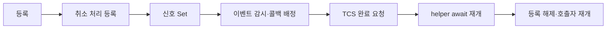

# 단건 요청의 비동기 대기 비용 분해

측정일: 2026-10-27. 목적: 추가 지연을 대기 등록·콜백·재개·GC로 구분한다.
제품 소스는 변경하지 않았다. 계측은 artifacts의 별도 빌드에만 삽입했다.

## 1. 결론

- 분리한 비동기 대기에서 가장 큰 구간은 Set 직전 → 콜백 첫 계측이다.
  대표 평균 약 11.45µs로, 등록 약 3.43µs와 완료 요청 → helper 재개 약 1.08µs보다 컸다.
- 실제 1024자 단일 요청·응답에서는 왕복당 평균 대기 등록 2회, 콜백 2회를 관측했다.
- GC를 제거한 전체 요청 비교에서도 현재 방식의 지연 차이가 남았다.
  “추가 지연은 GC 때문”이라는 설명은 충분하지 않다.
- 위 구간에는 Windows 이벤트 감시와 ThreadPool 콜백 배정이 함께 들어간다.
  이것을 모두 순수 스케줄러 비용 또는 기존 대비 추가 비용이라고 부르지는 않는다.
- 우선 조사 대상은 신호→콜백 경로와 반복 등록이다. 이 자료만으로 객체 풀링부터 적용할 근거는 없다.

## 2. 분리한 대기 1회의 측정

현재 RegisteredEventWait의 실제 소스를 별도 진단 실행 파일에 링크한 control과,
동일 소스를 복사해 시간 표시만 추가한 phases를 비교했다.
계측 소스는 제품 프로젝트에 포함하지 않았다. cancel/timeout/Task 완료 정책은 유지했다.

조건: 같은 프로세스의 Windows AutoResetEvent, 재사용 CancellationTokenSource,
일회성 RegisterWaitForSingleObject, RunContinuationsAsynchronously.
등록 메서드가 반환한 뒤 Set하므로 콜백이 선행하는 경우를 배제했다.
제품 MMF·KableSession·장비 처리는 이 실험에 포함하지 않았다.

각 프로세스에서 5000회 워밍업 후 30000회 측정, control/phases 각각 독립 프로세스 5회.
매 측정은 NoGCRegion이 활성 상태이며 GC 횟수 증가가 없음을 확인했다.
단계별 samples는 총 150000개, control도 150000회다.
측정 중 histogram/집계 객체를 반복 생성하지 않고 0.1µs 구간으로 집계했다.



표의 값은 회차별 평균 또는 p99의 5회 중앙값이다.

| 계측 구간 | 평균 대표값 | p99 대표값 |
| --- | --- | --- |
| RegisterWaitForSingleObject 호출 | 3.43µs | 10.0µs |
| 취소 등록 준비 | 0.25µs | 0.5µs |
| Set 직전 → 콜백 첫 계측 | 11.45µs | 53.0µs |
| TCS 완료 요청 직전 → helper await 재개 | 1.08µs | 4.5µs |
| Unregister 호출 | 0.32µs | 3.7µs |
| Unregister 완료 → 진단 호출자 재개 | 0.41µs | 1.0µs |

첫 구간 전의 TCS 준비, 취소 등록 해제, helper/진단 호출부 등의 비용은 표에 모두 분해되지 않았다.
각 구간 p99나 각 회차 중앙값을 합쳐 요청 전체 p99로 계산하면 안 된다.
계측 없는 control의 전체 대기 평균은 회차별 16.07~25.53µs,
phases는 16.94~22.39µs로 변동했다. 계측 오버헤드를 고정 숫자로 빼서 보정하지 않았다.
관측된 평균 할당은 control 약 565B/회, phases 약 669B/회였다.
여기에는 진단 caller의 async Task 등이 포함되고 phases에는 계측 객체도 포함된다.
이 값을 제품의 정확한 대기 객체 크기나 순수 TCS 할당으로 해석하지 않는다.

기존 동기 대기도 OS 깨우기·스케줄링 비용이 있다. 위 표 전체가 기존 대비 순증가분은 아니다.
분리 실험은 등록 완료 후 신호를 보내지만 실제 처리에서는 등록과 데이터 생산이 겹칠 수 있다.
따라서 위 비용에 2를 곱해 제품 왕복 지연이나 과거 p99 40→50µs의 증가분으로 대입하지 않는다.

## 3. 실제 요청당 등록 횟수

현재 전송을 별도 빌드해 helper 진입과 콜백에 Interlocked 카운터만 추가했다.
제품 바이너리/소스에는 카운터를 추가하지 않았다.
KableSession → MMF → 에코 → MMF → 요청 매칭의 전체 요청 경로를 사용했다.
단일 연결, 1024자 ASCII+LF, 실행당 20000회 요청, 워밍업 5000회다.

GC 허용 5회와 NoGCRegion 5회, 총 10개 실행에서 모두 다음 평균을 관측했다.

| 지표 | 요청 1회당 평균 |
| --- | --- |
| 대기 helper 등록 진입 | 2.0000회 |
| 대기 콜백 실행 | 2.0000회 |

이 숫자는 해당 workload의 평균이며 모든 트래픽 패턴에 대한 고정 규칙이 아니다.
카운터 빌드와 계측 없는 현재 빌드의 평균 지연은 같은 규모였지만, 완전한 무관측성은 보장하지 않는다.

## 4. GC를 제외한 대조 측정

동일한 현재 Kable/Core와 최적화 전 전송(baseline), 현재 관리형 전송(managed), counter 빌드를 사용했다.
세 빌드의 Engine/Core SHA-256이 같음을 확인했다.
각 조건을 독립 프로세스 5회 측정했고, 빌드/GC 실행 순서를 회차별로 반전했다.
모든 조건에 동일한 워밍업과 측정 전 GC 정리를 적용했다.
NoGCRegion은 256MiB 예산을 확보하고, 활성 상태·GC 발생 0회·중단시간 0을 검증했다.

아래는 5회 평균 또는 p99의 중앙값이다.

| 조건 | baseline 평균 / p99 | managed 평균 / p99 |
| --- | --- | --- |
| GC 허용 | 58.64 / 119µs | 72.28 / 175µs |
| GC 발생 없이 측정 | 67.19 / 138µs | 74.68 / 159µs |

GC가 없을 때도 현재 방식의 평균 차이 약 7.49µs, p99 차이 21µs가 남았다.
그러나 GC를 끄는 것이 이번 환경에서 모든 수치를 낮추지는 않았다.
예약된 heap 크기·실행 시점·JIT/스케줄링 변동도 있어 GC 허용/제외 차이를 그대로 원인별 기여도로 빼지 않는다.
baseline 첫 실행의 p99 675µs도 원본에 남겼으며 임의 제외하지 않았다.

GC 허용 전체 할당은 baseline 약 6849B/요청, managed 약 7793B/요청이었다.
평균 GC 누적 정지시간은 각각 실행당 약 8.98ms와 10.36ms였다.
추가 할당·GC 영향은 존재하지만 GC가 없어도 차이가 남는다는 점을 우선 확인했다.

이번 절대 지연값은 이전 60초 시험의 23.16/25.46µs와 다르다.
부하 길이·워밍업·GC 준비와 실행 시점뿐 아니라 이전 기록과 Engine/Core 바이너리 해시도 다르다.
따라서 과거 p99 40→50µs의 정확한 원인별 분해로 이 숫자를 대입할 수 없다.
이번 실험 내부의 baseline/managed/counter 간 Engine/Core 해시는 동일하다.
현재 작업 트리의 기존 변경을 공통 의존성으로 사용했으며 제품 소스를 이 측정을 위해 수정하지 않았다.
환경: Windows 11, Core 7 150U, .NET 10.0.9/SDK 10.0.301, Release, 최소 worker 20.
실장비·별도 프로세스 사이의 성능이나 운영 지연 SLA를 측정한 것은 아니다.

## 5. 후속 판단

우선은 반복 등록을 줄이거나 이벤트 전달/재개 경로를 개선할 수 있는지 비교할 단계다.
객체 풀링은 등록/할당의 일부를 줄일 수 있어도 가장 큰 신호→콜백 구간까지 해결한다고 가정하면 안 된다.
영속 등록이나 대기 객체 재사용은 늦은 콜백·취소·새 세대 오염을 막는 별도 설계와 회귀 테스트가 필요하다.
이번 요청에서는 측정 도구와 보고서만 추가했으며 제품 대기 방식은 변경하지 않았다.

## 6. 재현과 검증

```powershell
./tests/Kable.SharedMemory.WaitDiagnostics/Measure-WaitPhases.ps1 -Iterations 30000 -Rounds 5
./tests/Kable.SharedMemory.Benchmarks/Measure-WaitGc.ps1 -Iterations 20000 -Rounds 5
```

첫 스크립트는 제품 helper를 읽어 계측 복사본을 만들며 문자열 패치가 맞지 않으면 실패한다.
둘째는 과거/현재 전송과 counter 복사본을 분리 빌드하고 reply 내용 및 NoGC 조건을 검증한다.
모든 진단 빌드는 경고 0개·오류 0개였고 timestamp 순서와 단계당 30000개 기록을 검사했다.
전체 요청 비교는 총 30개 실행, 600000개 측정 요청에서 응답 일치를 확인했다.

원본: [단계 측정 10개](benchmarks/SharedMemoryWaitPhases.jsonl),
[GC 대조 30개](benchmarks/SharedMemoryWaitGcProfiles.jsonl).
로컬 빌드/계측 소스는 artifacts/shared-memory-wait-cost/에 보관한다.
