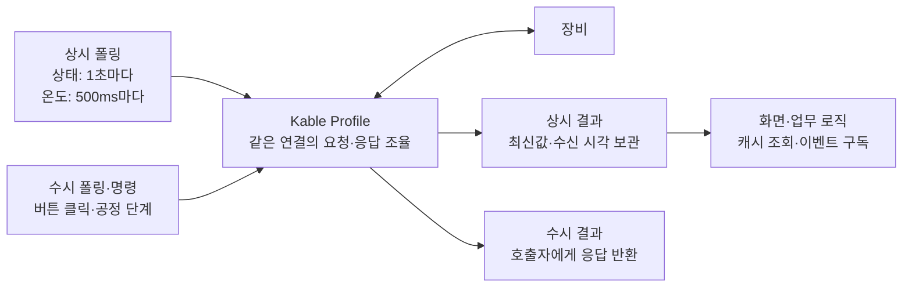
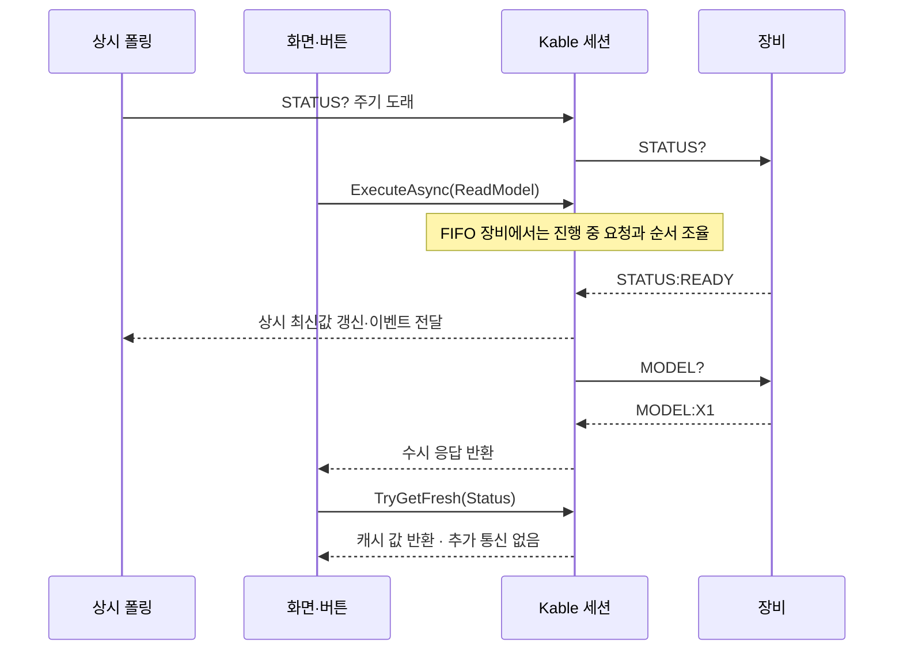
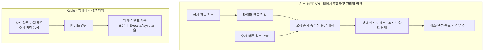

# Kable: 상시 폴링은 등록하고, 수시 조회는 호출하세요

**장비별 항목과 간격을 등록하면 Kable이 반복 조회·응답 매칭·최신값 보관을 관리합니다.**
타이머와 수신 루프를 업무 코드마다 작성하는 대신, 필요한 데이터와 실행 시점을 정합니다.

## 상시 폴링과 수시 폴링을 한 연결에서



| 구분 | 언제 실행하나? | 등록·사용 API | 앱에서 작성하는 것 |
| --- | --- | --- | --- |
| **상시 폴링** | 연결 후 등록한 간격으로 반복 | `AddPeriodic` → `TryGetFresh` / `PeriodicDataReceived` | 항목·명령·간격, 값 사용 로직 |
| **수시 폴링·명령** | 버튼 클릭이나 업무 단계에서 호출할 때 | `AddAperiodic` → `ExecuteAsync` | 명령 등록, 필요한 곳의 호출 한 번 |

수시는 호출할 때 한 번 실행합니다. 반복 조회할 항목은 상시에 등록합니다.
`PeriodicItem`과 `OnDemandCommand`처럼 Enum 타입도 나누면 상시 캐시 조회와 수시 실행을 구분해서 작성할 수 있습니다.

## 이 정도 설정으로 폴링과 수시 조회를 함께 구성

.NET 8/10 콘솔 예제입니다. `dotnet add package Kable` 후 장비 주소·명령을 바꾸어 사용합니다.

```csharp
using Kable.Engine.Profiles;

var config = new KableProfileConfig<PeriodicItem, OnDemandCommand>()
    .UseTcp("192.168.0.100", 9000)
    .AddPeriodic(PeriodicItem.Status, "STATUS?", TimeSpan.FromSeconds(1))
    .AddPeriodic(PeriodicItem.Temperature, "TEMP?", TimeSpan.FromMilliseconds(500))
    .AddAperiodic(OnDemandCommand.ReadModel, "MODEL?");

await using var device = await KableProfileManager.ConnectAsync(config);

string model = await device.ExecuteAsync(OnDemandCommand.ReadModel);
Console.WriteLine(model);

await Task.Delay(TimeSpan.FromSeconds(10));
if (device.TryGetFresh(PeriodicItem.Status, TimeSpan.FromSeconds(3), out var status))
    Console.WriteLine(status);

enum PeriodicItem { Status, Temperature }
enum OnDemandCommand { ReadModel }
```

- `AddPeriodic` 두 줄로 서로 다른 간격의 상시 조회를 등록합니다. 별도 반복문·타이머 코드는 필요 없습니다.
- `ExecuteAsync`는 상시 폴링과 같은 세션에서 수시 명령을 요청하고 해당 응답을 받습니다.
- `TryGetFresh`는 장비에 재조회하지 않고 유효 기간 안의 캐시를 읽습니다.
- 예제의 10초는 연결을 유지하는 데모 시간입니다. 첫 응답이 없거나 값이 오래되면 `TryGetFresh`는 false입니다.

문자열 키를 선호하면 `KableProfileConfig`의 `AddPeriodic` / `AddCommand`를 사용할 수 있습니다.

## 상시 조회 중 버튼을 눌렀다면?



FIFO 동작 예시입니다. 수시 명령이 진행 중인 요청을 중단하거나 항상 우선 실행되는 의미는 아닙니다.
화면에서 이벤트를 처리할 때는 앱의 UI 스레드 전환 규칙을 적용합니다.

## 기본 .NET API로 같은 기능을 만들면?



| 추가 요구사항 | 기본 API 위에서 관리할 작업 | Kable이 제공하는 기능 |
| --- | --- | --- |
| 주기별 상태 수집 | 반복 작업·간격·종료 수명 | Profile 자동 폴링 |
| 상시 + 수시 동시 사용 | 하나의 연결을 공유하는 요청 순서·응답 대기 | FIFO 요청 조율 |
| 화면·업무의 최신값 사용 | 항목별 값·수신 시각·유효 기간 | 최신값 캐시·`TryGetFresh` |
| 조회 중 알람 수신 | 응답과 자발 메시지 분류·전달 | 코덱 분류·세션 전달 경로 |
| 취소·연결 종료 | 대기자 종료·늦은 응답 정책·자원 정리 | 세션 수명 계약·`DisposeAsync` |
| 단절 후 복구 | 새 연결 교체·재시도 수명 | 별도 선택 기능 `ReconnectingKableClient` |

기본 API로도 구성할 수 있는 기능입니다. Kable은 이 공통 통신 동작을 제공해 앱에서 작성·유지할 영역을 줄여줍니다.
복구 래퍼는 별도 기능이며 위 Profile 설정만으로 자동 재연결을 켠다는 의미는 아닙니다.

[API별 시작 가이드](GETTING_STARTED.md) · [실패 처리·새 연결](ERROR_HANDLING.md) ·
[세션 수명 계약](CONNECTION_LIFECYCLE.md) · [검증 보고서](benchmarks/FaultComparison.md)
